# lalala

Dark trading terminal. Hyperliquid candles are live on the right; the left
column tracks the current Polymarket five-minute BTC up/down market.

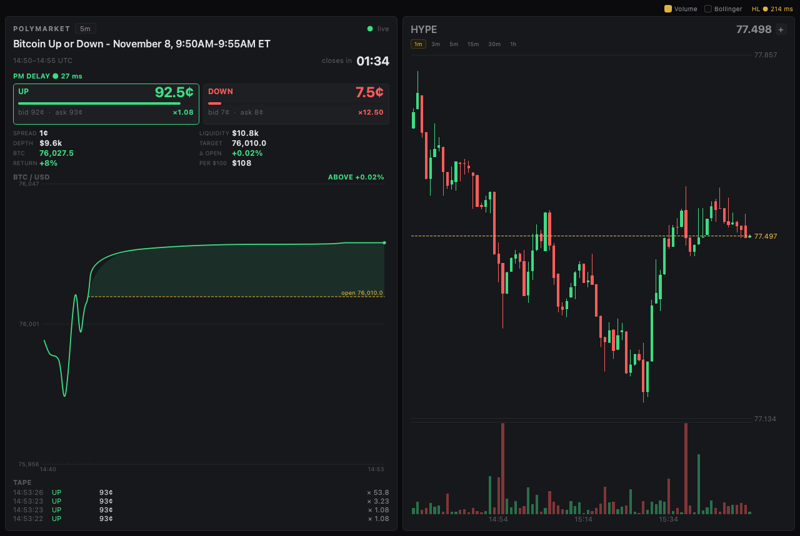

## Run

```sh
uv sync          # PySide6, httpx, websockets
uv run lalala-hub
```

`lalala-hub` is the entry point: one window with a folded icon rail down the
left and, on the right, whichever view the rail has selected — Home, Live, the
strategy builder, the backtest engine or Settings. The rail swaps the view
**in place** (the old one is destroyed, a new one built), so Live, the builder
and the backtest (and Settings) run inside the hub rather than in extra
top-level windows. Colour-coded venue dots sit at the bottom of the rail — each
with the venue's latest round trip and its **balance** (`$1.2k`), so the two
balances are on screen on every view, not just Home — over a light-red quit
button.

Home's status row carries six cards: the active strategy, the last backtest,
the open position, the next Polymarket market, and a **balance per provider**
(Hyperliquid and Polymarket, with the current side) — refreshed from the venue
every 30s when that account is connected.

The other windows can still be launched on their own:

```sh
uv run lalala          # the terminal alone (Polymarket column + Hyperliquid candles)
uv run lalala-strat    # the backtest/strategy window
uv run lalala-builder  # the strategy builder
```

The venue SDKs — needed only to place orders or test a connection — stay out of
the default install, so the GUI opens with no credentials, network or wallet
keys present. Add them when you want them:

```sh
uv sync --extra venues   # hyperliquid-python-sdk, py-clob-client, eth-account
```

### Settings

The hub's Settings view (the gear in the rail) is live:

- **Accounts** — a Hyperliquid API-wallet address + key, and a Polymarket key +
  funder address. Addresses, network and signature type go to
  `~/.config/lalala/settings.json`; private keys go to the **macOS Keychain**
  (a `0600` `secrets.json` is the fallback elsewhere, and in tests). **Test
  connection** really connects through the venue adapters and reports the
  balance or the reason it failed. **Disconnect** signs a venue out — it drops
  the key and the address and saves.
- **Backtest defaults** — capital, sizing, TP/SL, cash cap, timeframe and span,
  fees, and Dynamic TP. These seed the backtest window.
- **Trading defaults** — the trade form's size and leverage, the confirm/stake
  limits, and **live orders** (off by default — see below).
- **General** — the hub's start page and where downloaded candles live.

`settings.json` is safe to read and sync; the keys never touch it.

### Trading

Orders are **dry-run by default**. The trade form's Buy / Sell and the
Polymarket column's bet buttons keep a paper position unless you turn on
**Place real orders** in Settings → Trading defaults *and* the venue is
connected. With it on, an order still waits for the confirm dialog (unless you
turn that off), stakes are capped at the max stake, and the order is signed and
submitted through the venue adapter on a worker thread — the same adapters the
Connection test uses. The result (fill, rejection, or the reason) shows under
the buttons. Wiring is in `lalala/orders.py`.

### Saved state

`~/.config/lalala/` holds `settings.json`, `strategies.json`, `runs.json` and
the key store. Point these elsewhere with `LALALA_SETTINGS`, `LALALA_SECRETS`,
`LALALA_STRATEGIES` and `LALALA_RUNS`; `LALALA_KEYCHAIN=0` forces the file
store, and `LALALA_DATA` overrides the candle folder.

Tests (headless, no network, no sockets):

```sh
uv run pytest -q
```

Lint and tests, exactly as CI runs them:

```sh
uv run ruff check src tests
uv run pytest -q
```


The images in this file live in `docs/images/`; regenerate them offscreen with:

```sh
uv run python tools/screenshots.py
```

## What works now

**Top bar** — Hyperliquid's own WebSocket ping/pong round-trip, measured on
the real socket path rather than an HTTP timer, so it reflects what order flow
would experience. Refreshed every 2s. Green ≤120ms, amber ≤300ms, red above.
Polymarket's equivalent sits at the top of its column, above the tiles,
refreshed every 5s while a market is open.

The two numbers differ because the venues answer at different speeds, not
because one probe is broken: from the same machine, TCP + TLS to both edge
endpoints completes in ~25ms, while Hyperliquid's `/info` takes 250–370ms to
first byte and Polymarket's CLOB `/time` takes 75–110ms. The extra time is the
venue's application/origin, and the WebSocket pings show the same split.

**Market cards** (right side)

- Main card opens on `HYPE` (`DEFAULT_MARKET`); click its name to change it.
- Candlestick chart, 1m by default, switchable to 3m / 5m / 15m / 30m / 1h —
  by pill or with the `1`-`6` keys. Bars are pushed by the venue's `candle`
  stream as trades print, so the last bar updates sub-second.
- 300 bars of history arrive with the card; panning to the left edge asks the
  venue for the next 300 and appends them. The viewport does not jump when a
  page lands — the new bars sit off-screen to the left, ready for the next
  drag. When the venue returns nothing older, the chart stops asking.
- Live mid price in the card header, refreshed from `allMids`.
- **+** sits on the newest card; **⌘T** does the same. Up to 3 tiles
  (`MAX_TILES`), each with its own market and timeframe.
- Any card can be closed while another survives, including the first one; the
  next card takes over the main-card slot.
- Picking a market collapses the search row. Click the coin name to reopen it.
- Time axis along the bottom: `HH:MM` for intraday and `dd Mon HH:MM` at 1h.
- Every split uses the same 8px transparent gap, horizontally and vertically,
  so all cards sit identically on the canvas.
- Cards share the stack proportionally as the window resizes. The window
  minimum is 620×520 so four cards always fit; below that the splitter would
  stop distributing and the last card would overflow.

No drop shadows: a `QGraphicsDropShadowEffect` re-renders the entire card into
a pixmap on every repaint, which is an extra full-card pass per market update.
The dark panel against the lighter canvas already separates them.

**Chart overlays** — two checkboxes in the top bar, next to the latency
readout. They are global: toggling one applies to every card, including tiles
created later.

| Toggle | Default | What it draws |
| --- | --- | --- |
| Volume | on | Per-candle volume as a strip under the price plot, scaled to the visible peak, coloured by candle direction |
| Bollinger | off | 20-period, 2σ bands over closes: shaded envelope, upper/lower edges, dotted middle |

Bands stretch the price scale only by up to half the candle range in each
direction. A wide envelope after a gap would otherwise flatten the candles into
a single line; past that cap the bands clip at the plot edge. Volume needs
about 90px of chart height, so it hides itself in very short cards rather than
squeezing the candles.

**Chart navigation**

| Input | Action |
| --- | --- |
| Wheel over the price axis | stretch / squash the price range |
| Wheel over the time axis | zoom the time range |
| Wheel over the plot | zoom the time range |
| Shift + wheel | pan two candles per notch |
| Drag | grab the trail: sideways walks through time, up / down moves the price window |
| ← / → | pan one candle (Shift: ten) |
| ↑ / ↓ | zoom the time range |
| Home | jump to the oldest candle, loading a page if needed |
| End, `0`, double-click | reset: live edge, fitted price range, 1.0 price zoom |
| `1` … `6` | switch timeframe (1m, 3m, 5m, 15m, 30m, 1h) |

The two axes are separate. The price gutter on the right changes only the
vertical scale — how far apart prices sit — and leaves the number of candles
alone; each wheel notch is 10%, clamped between 0.2× and 20×. The bottom time
axis changes only the time range. The pointer turns into a vertical resize
cursor over the price gutter and a horizontal one over the time axis, so it is
clear which wheel you are about to use. Over the plot it is an open hand: the
whole trail can be grabbed.

Dragging moves the chart with the pointer. Sideways walks one candle per
on-screen slot, so a deep zoom needs a longer drag but still lands exactly on a
bar. Up and down pull the price window with the pointer, one pixel for one
pixel, and the grab is not undone by the next tick. That is what recovers the
live bars when a deep zoom plus a price stretch has pushed them out of view. If
the live price is off the plot, its label and a small wedge stay pinned to the
edge it left through, so it is obvious which way to drag back. Double-click (or
`End` / `0`) releases the grab and fits the range again. A press that moves
less than a few pixels stays a click.

Zooming out stops at 600 bars (`MAX_VISIBLE`). Before that cap the requested
window kept growing while the series was short — invisibly, since only the
existing bars can be drawn — and then paging in history made every repaint
draw thousands of bars: 25ms at 3000, 51ms at 6000. Bounded, a repaint is ~5ms
no matter how far back the chart is paged.

The vertical scale pivots on the centre of the natural price range, so zooming
does not make the chart jump. Scrolling back freezes the viewport — new bars no
longer drag the view forward — and shows `N back · double-click to reset`; the
same hint says `price grabbed` after a vertical drag. Until then it is pinned to
the newest candle.

**Deeper history.** The first 300 bars cover roughly 5 hours at 1m. Reaching
the left edge (drag, wheel, `Home`, or the panning keys) fires one REST
`candleSnapshot` request for the 300 bars before the oldest one held. Requests
are serialised per (coin, interval) and a burst of drag events collapses into
one, because the venue answers bursts with HTTP 429. A page that comes back
empty means the market has no older data and the chart stops asking; a page
that fails leaves the chart free to retry on the next pan. A landing page never
moves the viewport: the new bars sit off-screen to the left, and the next drag
walks into them.

Digits `1`-`6` switch the timeframe on whichever card has focus; the chart
takes focus when you click it. Inside the search box they type normally — the
window-level fallback only sees keys the focused widget already declined.

**Search** covers 377 markets: 235 main perps plus 142 HIP-3 markets on the
`xyz` dex, which is where commodities and equities live. Results render as a
list inside the card, not a popup — a popup grabs the keyboard on macOS after
the first keystroke.

Plain language and classic names are aliased (97 entries): `oil` → `xyz:CL`,
`gold` → `xyz:GOLD`, `apple` → `xyz:AAPL`, `semis` → `xyz:SMH`,
`bonds` → `xyz:TLT`. Trading 212–style ETF tickers map onto the index products
Hyperliquid actually quotes: `spy`/`s&p` → `xyz:SP500`, `qqq`/`nasdaq` →
`xyz:XYZ100`. Note that **SPY, QQQ, GLD, IWM, VOO and DIA are not listed at
all** — those exact contracts do not exist on the venue, so the alias is the
closest tradable equivalent.

**Polymarket column** (left) — one market at a time: the five-minute Bitcoin
up/down window that is open right now.

- `btc-updown-5m-dynamic_time_utc` is the template. Real slugs are
  `btc-updown-5m-<unix ts>`, with the timestamp aligned to 300 seconds, so the
  panel derives the slug from the clock and rolls to the next window by itself.
  Nothing to configure; the countdown and question change on the boundary.
- **Outcome tiles** — UP and DOWN in cents, with a probability bar and the best
  bid/ask on each. Click a tile to make its book the one the spread and depth
  stats describe.
- **Clock** — the window in UTC and a live countdown; white, amber inside a
  minute, red inside 30 seconds.
- **PM delay** — a bold `PM DELAY ● NN ms` readout at the top of the column,
  above the tiles: Polymarket's own WebSocket ping/pong, green ≤120ms, amber
  ≤300ms, red above. It runs on a second, subscription-free socket, so a busy
  market that trips the venue's slow-consumer guard cannot blank it.
- **Stats** — spread, Gamma liquidity, top-of-book depth (the price × size of
  the best eight levels on each side), the window-open **target**, the live
  Hyperliquid BTC perp mid, and the signed percent from the target to it.
  Above-target reads green, below reads red.
- **Return** — what the selected outcome pays if it wins: `RETURN` is the
  profit at its ask, `PER $100` the cash back on a $100 stake. A winning binary
  share always settles at $1.00, so a 64-cent buy returns $1.56, or +56%. The
  price comes from the live book (its mid when the book is one-sided), never
  from Gamma's listing snapshot, which drifts late in a window. Each tile also
  carries its own multiple when the column is wide enough to fit it without
  clipping the quotes.
- **BTC chart** — a rolling fifteen-minute view of the underlying, with the
  current window's target as a dashed line and the gap shaded green above / red
  below. A rollover does not reset the line: the previous windows scroll left
  while the new target segment grows from the right edge. Five-minute
  boundaries get a tick and a time label, not a full-height rule, so the line
  stays one unbroken curve. The view ends ~1.5s behind live — more than the
  one-second sample interval — so a fresh sample always lands ahead of the
  cursor. The newest 130 seconds take most of the plot width, so the live
  edge advances a few pixels a second instead of crawling sub-pixel; older
  data keeps even spacing and only boundaries clear of that slice are labelled.
  One-minute bars fill the span before live sampling begins, so the line
  starts at the left edge of the view from the first second instead of
  growing in from the right.
  The tip is interpolated between stored samples, then eased, and each sample
  is eased from the one before it, so a one-tick spike reads as a bend instead
  of a needle. The polyline then runs through a quadratic curve at every
  corner. The y-range eases too. An hour of samples is retained.
- **Tape** — the last twelve prints, newest first, with the outcome, price and
  fractional share size.

Sources: Gamma for the market and its tokens, CLOB `/book` for the initial
snapshot, then one WebSocket subscription to both tokens (`book`,
`price_change`, `last_trade_price`). Separately, one Hyperliquid `1m`
`candleSnapshot` per window supplies the target (the window open) and
backfills the line across the visible span; live BTC quotes come from the
`bbo` channel, because
`allMids` can be several seconds apart on a quiet book. Books and the tape are
cleared when the window rolls; the price line keeps rolling. The socket
reconnects within the same window on a drop. Bets are placed from the stake row
under the outcome tiles — dry-run unless live orders are armed (see Trading).

The target is the open of the Hyperliquid bar at the window start. Polymarket
resolves on Chainlink's BTC/USD TWAP, not on Hyperliquid, so within a few
dollars of the line the venue can disagree with the chart; the level is a
reference, not the settlement print.

The wire is fast: a busy five-minute market pushes several hundred book frames
a second. All of them are folded into the held books and the tiles, but the
price chart is painted from the `bbo` stream at its own pace, so a live column
costs roughly the same as the candle feed instead of pinning a core.

## Why Python here

| Need | Consequence |
| --- | --- |
| Polymarket order signing is EIP-712 over secp256k1, plus L2 API creds derived from the wallet | Reimplementing this in C/C++ is the main source of rejected orders; `py-clob-client` is the maintained path |
| Hyperliquid signing and WS framing | `hyperliquid-python-sdk` for orders; public data needs no SDK at all |
| GUI must stay smooth while sockets stream | Qt6 renders in C++; Python only orchestrates, and all venue I/O lives on a separate asyncio thread |

The GUI thread never awaits network calls. `MarketFeed` runs on the
`AsyncRunner` loop and publishes Qt signals, which Qt delivers queued onto the
main thread. The chart itself is hand-painted with `QPainter` — no charting
dependency.

## Layout

```
src/lalala/
  app.py           QApplication bootstrap
  theme.py         colours + the whole stylesheet (app-level, so popups inherit)
  palette.py       the hub's palette (shared by the hub and Settings)
  fonts.py         the bundled Inter / JetBrains Mono, registered at startup
  logs.py          the silent log: a rotating file, never the console
  main_hub.py      the hub window: rail, in-place views, feed wiring
  hub_widgets.py   the hub's small builders and paint-it-yourself widgets
  settings_view.py the Settings screen: accounts, defaults, safety limits
  settings_widgets.py  the Settings builders and the venue connection tester
  settings.py      chart feel from ~/.config/lalala/settings.json + env overrides
  accounts.py      public account settings + the private keys, in the keychain
  orders.py        placing orders: the worker, the arming gate, the adapters
  positions.py     the one open paper position, shared across the hub's views
  trade_form.py    the size / leverage / buy-sell form under a market's chart
  strat.py         entry point for the blank backtest/strategy window
  strat_window.py  second window: run + inputs on top, results below
  strat_tiles.py   the history tile: span picker, resolution, coverage, actions
  strat_playback.py the left tile: a streamed walk over the whole span
  strat_params.py  the backtest tile: a gallery of run inputs
  strat_strategy.py the strategy tile: which entry rule to run
  strat_builder.py the builder window: strategy, entry and exit rules
  strat_rules.py   one rules tile: Rules/Formula/Code over one formula
  strat_conditions.py  the Rules tab: conditions in groups, read from a formula
  autocomplete.py  completion for the code editor and the formula slots
  formula.py       the entry/exit formula language: parse and check (no Qt)
  formula_eval.py  run a formula over bars: indicators, signals, the walk
  formula_builder.py the drag-and-drop formula builder (pills, chips, slots)
  formula_palettes.py the builder's palettes: the sources you drag from
  strat_report.py the right rail: the rule run over the candles on disk
  strategies.py    saved strategies: one JSON file, read and replaced by name
  runs.py          saved backtest runs: span, params, strategy and trades
  core.py          the walk: the Rust core when built, Python fallback
  strat_results.py the results tile: three live curves, legend underneath
  candles.py       the local 1m candle store: paths, coverage, CSV helpers
  candle_download.py  Binance 1m fetch, paged and resumable, on its own loop
  main_window.py   window, top bar, feed wiring, tile lifecycle, watch set
  panels.py        Card chrome, MAX_TILES
  cards.py         CandleChart, Timeframes, MarketSearch, MarketCard
  market_data.py   parsing, price formatting, candles, bands, search (no Qt)
  feed.py          Hyperliquid streams, latency probe (QObject + asyncio)
  polymarket_data.py   slugs, Gamma/CLOB/WS parsing, formatting (no Qt)
  polymarket_feed.py   one 5m market: resolve, snapshot, stream, roll over
  polymarket_panel.py  outcome tiles, countdown, BTC/target chart, tape (QPainter)
  settings.py      chart feel from ~/.config/lalala/settings.json + env overrides
  venues/
    base.py         Venue protocol for order placement (not used by the UI yet)
    hyperliquid.py  authenticated REST/WS adapter (orders, balances)
    polymarket.py   CLOB adapter (orders, books)
    runner.py       asyncio loop on a worker thread
tests/             ~520 tests: parsing/search/aliases, slug math, candle + book
                   routing, chart pan/zoom, axis zoom, backfill paging,
                   shortcuts, overlays, the Polymarket panel, the split
                   strategy window and its tiles, the streaming walk over a
                   whole span, its strategy picker and benchmark curves, the
                   strategy builder window, its locked 21/47/32 columns, its
                   compact STRATEGY tile, the one rules tile and its switch, their rules
                   gallery and their code refusal, the footer that resets and
                   saves a draft, the saved strategies file, the drag-and-drop
                   formula builder, the formula language, its evaluator, the
                   results tile, the chart and backtest settings, the silent
                   log, and the candle store and downloader, the hub and its
                   in-place navigation, the paper position, and the Settings
                   screen and its account store

Downloaded history lives in `data/candles/` — one OHLCV CSV per year,
`BTC-<year>-1m.csv`, with a header row and columns
`timestamp, open, high, low, close, volume`. Only BTC is fetched, and only at
1m: a 3m / 5m / 15m / 30m / 1h series can be compacted from it later, so the
store never holds the same data twice. The history tile reads those files to
report which years of the selected span are missing (red) or only partly
downloaded (amber), and offers the same set of resolutions — `1m`, `3m`, `5m`,
`15m`, `30m`, `1h` — to run at.

**Download** (`data/candles`) pulls the missing years from Binance's public
`klines` endpoint, a thousand bars a page, resuming from the last row already
on disk and appending each page as it arrives, so an interrupted download keeps
what it got. The bar still forming is dropped, so the newest row is always a
closed candle. Progress reads as a percentage of the year being fetched; a
complete span hides Download and offers Start backtest instead.

The 1m store starts when BTCUSDT did (2017-08-17), so 2017 is only expected
from that day and its Download can still finish. A year is complete at 99% of
its expected minutes, which leaves room for the handful of venue outages even
a good year has.

## Strategy tile

The entry rule the run is pointed at, with a **Create a strategy** button on
the right. The button is still a placeholder and opens nothing; the builder
window it will open exists separately (`uv run lalala-builder`). Two rules so
far:

| Rule | What it does |
| --- | --- |
| `Random buy` | opens on a coin flip (3% of flat bars). Kept in the list on purpose: it is the baseline an entry rule has to beat, not a fallback. |
| `Bollinger reversion` | buys when the close falls below the lower band of a 20-bar, 2σ channel. |

Like the span and the parameters, a change here is only remembered until
**Run** / **Start backtest** is pressed.

## Strategy builder

A window of its own, not opened by the backtest window and connected to
nothing in it:

```sh
uv run lalala-builder
```

Two columns side by side, splitting the width **21 / 79** — a narrow rail on
the left, everything else on the right — separated by the same 8 px gap and
nothing else. The split is **locked**: dragging a handle does nothing, so the
share changes only when the window is resized.

The rail holds the small **STRATEGY** tile on top and the saved-strategies
list under it.
The rest holds one rules tile with the **results** under it, the rule taking
the upper part. The window does not have to fit two rules side by side any
more.

A **footer** spans the bottom of the window, as in the mock: the draft's name
on the left, and `Delete strategy`, `Reset` and `Save` on the right. `Reset`
clears the draft — name, bar and both rules. `Save` writes it to
`~/.config/lalala/strategies.json` under its name, replacing an earlier one of
the same name rather than piling up; it needs a name and rules that check out,
and the footer says which is missing. `Delete strategy` is described below.

The **STRATEGY** tile at the top of the rail is
`STRATEGY` and holds one row: a text field (`name` as its placeholder) taking
the slack, and a dropdown of `1m`, `5m`, `15m` and `1h` at its own width,
defaulting to `1m`. It is only as tall as the title and that row.

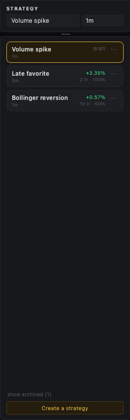

Under it sits the **saved-strategies rail** — one row per kept draft, most
recent first: the **name** on the left and the **return** it made over the same
tail of candles the results tile reads on the right, in the mock's own shape.
The draft you are on is lit; if it is not saved yet it shows at the top badged
`draft`. Clicking a row loads that strategy back into the editor, and
**Create a strategy** starts a fresh draft. The file is
`~/.config/lalala/strategies.json` (`LALALA_STRATEGIES` overrides it) — plain
JSON, one object per strategy with its name, bar and both rules as text; a
missing or broken file simply reads as empty.

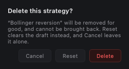

At the bottom, beside `Reset` and `Save`, a **Delete strategy** button sits
quiet until a saved strategy is on show — then it turns red. Pressing it opens
a small prompt: **Delete** removes the strategy from the file and clears the
editor, **Reset** clears the draft but keeps the saved copy, and **Cancel**
leaves both alone.

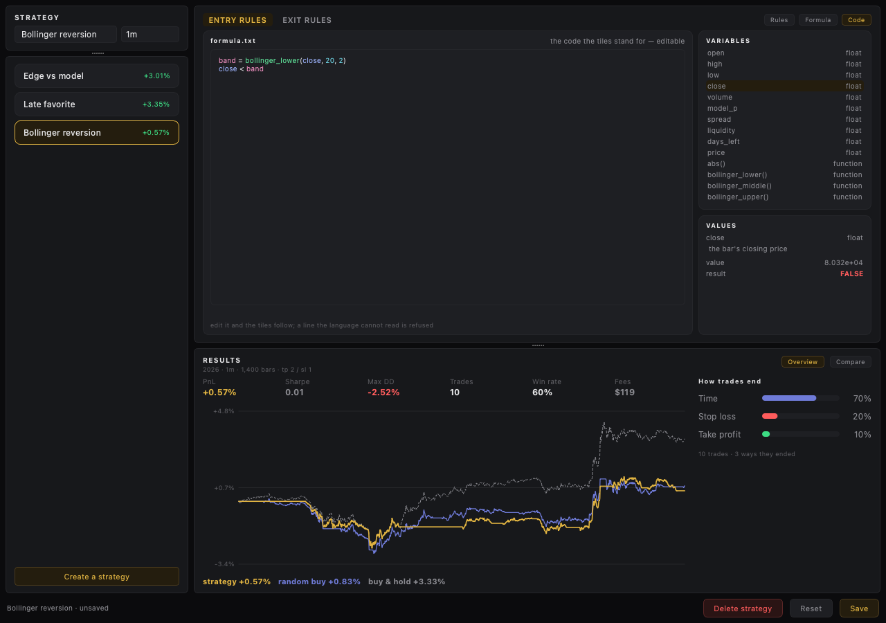

Under it the right-hand column has **one rules tile**, and **ENTRY RULES** /
**EXIT RULES** are the switch at its top: they are the same widget —
`strat_rules.RulesTile` — and `strat_rules.RulesSwitcher` keeps both, showing
one at a time. The `Rules` / `Formula` / `Code` pills beside them belong to
the side on show and follow it when you switch. That way either rule gets the
full width of the tile instead of the two squeezing into it.

Each side has **three tabs** — `Rules`, `Formula`, `Code` — and starts on
`Rules`, the condition editor. A **LET** section on top names series
(`band = bollinger_lower(close, 20, 2)`): `+ Add variable` adds one, and the
name it defines joins the Variables rail below. Then come the conditions,
gathered in dashed **groups**. A group starts with **one cell, active by
default** — the cursor is already in it, ready to fill. The little `+` under
the cells opens three things to add: a **Condition** (an operand, an operator
and a value), a **Math** operator (`* + - / …`) or a **Value** (`2`, `band`).
That is how `volume > sma(volume, 50) * 2` is one condition plus a math cell
and a value cell. Each group joins its terms with **All (AND)** or **Any
(OR)**, and the groups themselves are joined with AND — so several conditions
collect together in the group's dashed box. The rule as a formula is pinned at
the bottom left, with whether the rows make a valid rule and what the newest
bar said.

The **operands and the operator are picked, not typed**. The operator has its
own little list; the operands and values have **no dropdown at all** — a click
leaves the cursor in the box and the **Variables** rail fills it. The rail lists
the fields, the indicators and any name the LET rows define; picking one
**replaces** what is in the focused box. Only the value box takes typed text,
so a number like `0.03` can be written — the only name written free-hand is the
LET variable's own.

A cell's `×` shows **only when it can be deleted**: the sole condition of a
group, or the only group, carries no `×`. (The mock put signal options in the
right rail — side, confirmation bars, cooldown — but the backtest models none
of them.)

`Rules` is another way to write the same formula: it reads any condition that
is a flat AND / OR of comparisons into rows, keeps `name = …` lines as LET
rows, and keeps a condition it cannot break up as one raw expression. `Code` is
canonical both ways: typing it rebuilds the rows and the formula, and the
window re-runs the report. `Formula` is the drag-and-drop builder and `Code`
the same formula as text.

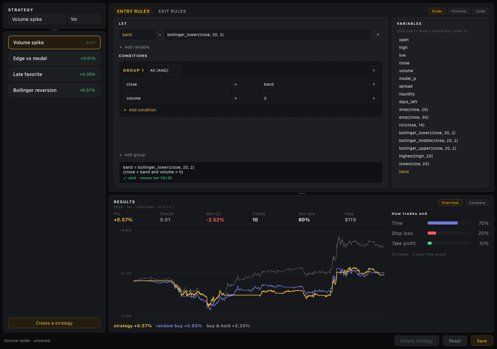

Typing a rule **autofills**: the `Code` editor and the `Formula` tab's value box
offer the fields, the indicators and the functions — `and or not` too — as you
type, and `Tab` / `Enter` takes the suggestion.

The `Formula` and `Code` panels have a natural size of their own and **scroll**
inside the tile rather than making it grow, so a narrow window keeps the rules
where they are and the panel moves under the cursor.

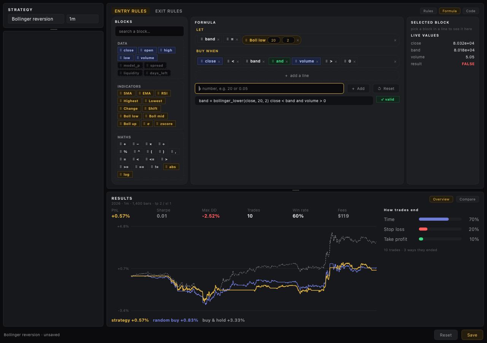

The `Formula` tab is three columns, as in the mock. **Blocks** is the small
left rail (200 px, fixed) — a search box over one dashed group per kind
(`Data`, `Indicators`, `Maths`, `Logic` — boxes, not different colours, so the
list reads as one surface), with **no scrollbar**: the wheel walks the list.
A **`Variables`** group sits above them, listing the names the rule defines, so
a named series can be dragged into the condition like any other block; it is
hidden until something is named.
The **Formula** takes the slack in the middle: the lines sit directly on the
card — no scrollbox of their own, so all of them show at once and the page
around the builder moves if a long rule needs more room — and the formula as
text is one small read-only line that scrolls sideways. The lines are grouped
into subsections: named series sit under **`Variables`**, which is always shown
with its **`+ Add variable`** button — that adds a named line above the
condition. That line is just the small **name field**, the one token you type
by hand (styled like the chips around it), and a fixed `=`; nothing else. Drag
a block onto the line to give it a value. The condition sits under **`BUY
WHEN`** on the entry side and **`EXIT WHEN`** on the exit side. The **Selected block** is
the right rail (a little under 250 px), pushed against the edge and scrolling
in place: its name, source and live values stay readable in a short tile.
Clicking a chip selects it: the card shows its name, its source and its window,
all editable, and under them the live values that name reads on the newest bar,
with the rule's result.

| | |
| --- | --- |
| 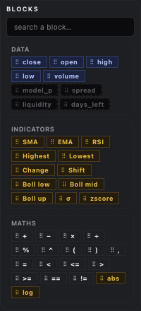 | 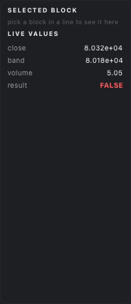 |

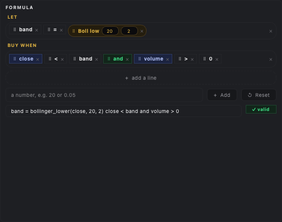

The `Code` tab is the code on the left, with a right rail holding `Variables`,
the whole vocabulary with its types, over `Values`, the last bar's numbers.
The two lists are stacked and **scroll in place**; `Variables` hides its bar so
the names get the width, while the page around them does not scroll, so the
code stays put while you read them. Clicking a word in `Variables` picks it:
the row stays lit and `Values` explains it in a line and shows its number on
the newest bar. The code block and the formula bar share the card's fill, with
only a border to mark them, so the text never sits on a darker patch.

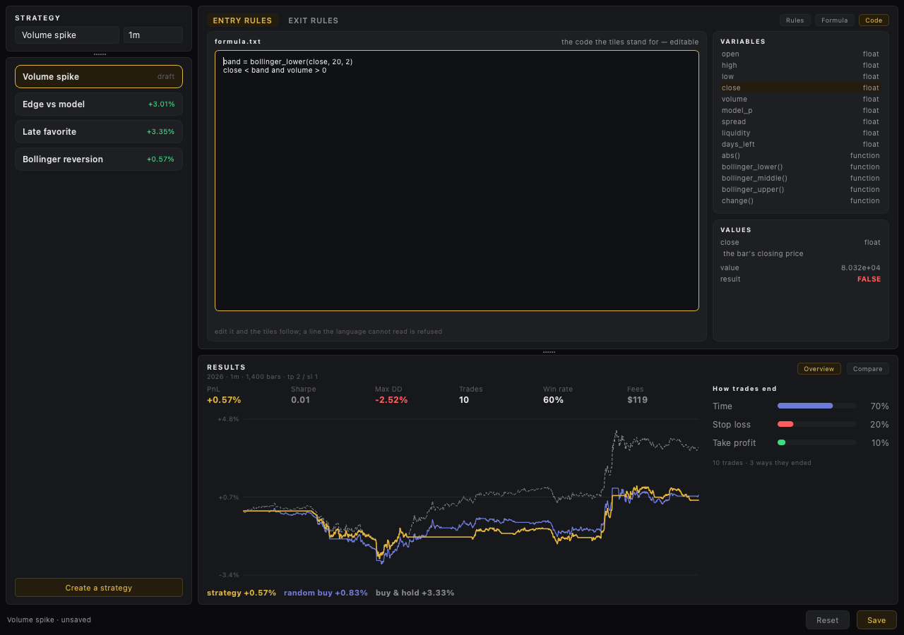

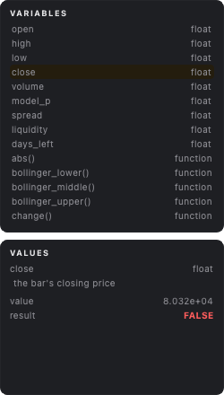

The palette carries the **market words** the mock shows — `model_p`, `spread`,
`liquidity`, `days_left` — beside the bar's own. Nothing here carries them: they
validate so a rule can name them, they evaluate to nothing, and the tile says so
under the rule (`⚠ spread: no history in a backtest`). The indicators gained `σ`
(`stdev`), `zscore`, and maths gained `log`.

The two read **different vocabularies**:

| Tile | May use |
| --- | --- |
| `ENTRY RULES` | the bar — `open high low close volume` — and the indicators |
| `EXIT RULES` | the open trade — `price entry tp sl pnl bars` — and plain maths only |

`pnl`, `tp` and `sl` are percentages; `price` is the close while the trade is
open; `bars` is how long it has been open. An indicator in an exit rule is
refused with `not here, this rule takes no indicators`, and a bar name like
`close` is an unknown name there.

Nothing is saved yet, and nothing is wired to the walk.

### The formula builder

The `Formulas` page is a drag-and-drop builder. A card holds the sources —
three rows of draggable **blocks**, then a box to type a number into:

| Row | Blocks |
| --- | --- |
| `DATA` | `close`, `open`, `high`, `low`, `volume` |
| `INDICATORS` | `SMA`, `EMA`, `RSI`, `Highest`, `Lowest`, `Change`, `Shift`, and the three Bollinger bands — each drops as one tile with its numbers inside |
| `LOGIC & MATHS` | `AND`, `OR`, `NOT`, `=`, parentheses, comma, arithmetic, comparisons |
| number box | type a value, `+ Add` puts it on the active line, `↺ Reset` clears every line |

Each block is a pill with a drag handle, coloured by what it is — data in
indigo, indicators in amber, `AND`/`OR`/`NOT` in green, maths neutral — and
each row wraps when the tile is narrow. The lines live in a scroll area, so
the card keeps its height however many of them there are.

The rules tile takes the column below `STRATEGY`, and either side gets all of
its width.

Under the card are the lines, one strip of chips each, read left to right. They
are split into two subsections: the variables under `LET`, and the last line —
the condition — under `BUY WHEN` (`EXIT WHEN` on the exit side). The `LET`
heading is hidden when there are no variables. A line wraps rather than
clipping, and the card grows to fit them:

```
LET  [band] [=] [Boll low 20 2]
BUY WHEN   [close] [<] [band]
```

An **indicator drops as a single tile** and nothing else comes with it: the
tile holds its own number — one for `SMA`, two for a Bollinger band — so `Boll
low` with `20` and `2` reads as `bollinger_lower(close, 20, 2)`. Edit a number
by typing in the tile; it rewrites the formula as you go.

A chip drags by its handle to reorder or move between lines, and its `×` takes
it off; `+ add a line` adds a line and each line carries its own `×` to remove
it (the last one stays). A drag carries a picture of the block itself, so what
is moving is visible under the cursor, and the line it is over lights up as the
drop target. Long lines **wrap** rather than clipping. A blank run shows a
dashed `drag a block here`, and a live pill reads `✓ valid`, `✗ not valid` or
`— empty`.

The chips are only an editor. The formula **text** is the truth: it is rebuilt
from the chips and handed to `lalala.formula.parse`, so the same checker still
reports `line 2, column 9: unknown name 'clsoe'`, and the text is what a run
would use.

### The code view

`Code` is the same formula as text in a monospace editor. It is filled from the
tiles, and it can be typed in directly: whatever is written there is scanned,
checked, and rebuilt into tiles, so the two views never disagree. A name that
was never defined is flagged with its place, and defining it on a line above
clears it — the same rules the language has always had.

A line the language cannot even read — a stray character like `@` — is
**refused**: the previous code is put back and the reason is shown, rather than
leaving the tiles and the code out of step.

Reading text back keeps indicators whole: `bollinger_lower(close, 20, 2)` comes
back as one tile holding `20` and `2`, not a run of separate chips.

### Results tile

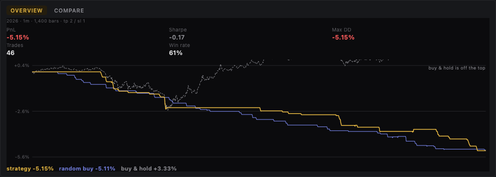

The tile keeps its `RESULTS` title, with the span under it, and **two
subwindows** as pills on the right — `Overview` and `Compare` — the way
`Rules` / `Formula` / `Code` sit in the rules tile. Only one is on show at a
time; `Overview` is the default.

`Overview` is a **split**: on the left the six figures in one row, then the
curve under them; on the right a rail listing **how the trades ended**, one bar
per reason, most-appearing first.

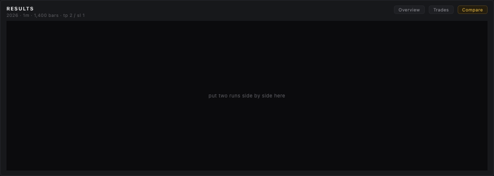

`Compare` puts the run beside its two stand-ins, from the same tail of candles:

- a row of **runs** — `Strategy`, `Random buy`, `Buy & hold`, and a `+ Add`
  placeholder — then the three curves over a **table** of the same figures
  (`PnL`, `Sharpe`, `Max DD`, `Win rate` for each);
- a **walk-forward** count over four folds (`1 / 4 positive`);
- a **TP × SL sweep** as a 5 × 5 heat-map, each cell the return of the run at
  that take-profit and stop-loss, red through green. A small key under the grid
  names the colour bands, and hovering a cell reads `TP 3 / SL 1 · +2.14%`.

`+ Add` lists the saved strategies; picking one re-parses its stored entry and
exit rules, runs it over the same bars with the same TP / SL, and gives it its
own chip, curve and table column. The strategy already on show is left out of
the list — it is the first chip — and so are names already added. The list also
greys out strategies whose rules no longer parse. Clicking a chip takes that run
back out, and a new rule clears the added strategies.

The sweep is a parameter search: it re-runs the whole span for each of the 25
take-profit / stop-loss pairs and colours the result, so a rule that only works
at one lucky setting shows a single bright cell among dark ones.

It recomputes only when it is on show, so the walk does not run behind
`Overview`.

Under the two rules, the report says what the rule did over the candles already on disk. It
takes the newest year in the store, keeps the tail of it (1,200 bars in view,
200 more behind them so the indicators have history), compacts them to the bar
the STRATEGY tile names, and runs `lalala.formula_eval.backtest`.

Six figures in **one row** — `PnL`, `Sharpe`, `Max DD`, `Trades`, `Win rate`,
and `Fees` — and under them three curves, drawn as **return since the start**,
on a scale that fits all three so every line is in view:

| Curve | What it is |
| --- | --- |
| **strategy** (amber) | the rule as written |
| **random buy** (indigo) | the same exits and fees, entries on a coin flip |
| **buy & hold** (grey, dotted) | the whole book in at the first bar, never sold |

The legend under the chart carries each one's running total. Return, not
balance: over a long span buy and hold compounds many times over while a rule
that is in and out of the market barely moves, and in dollars the first would
flatten the other two into the axis.

The **How trades end** rail says why each trade closed, by the clause of the
exit rule that fired — a clause reading `tp` is `Take profit`, `sl` is
`Stop loss`, `bars` is `Time`, anything else is the rule's own `Rule`, and a
trade still open at the last bar is `End of data`. The bars are sorted by how
often each reason appears, in the colour it takes (green, red, indigo, amber,
grey).

`tp` and `sl` are this tile's own defaults, since the run's parameters live in
the other window and nothing is wired between them yet. It downloads nothing
and writes nothing; an empty store says so instead of drawing an empty chart.

## The evaluator

`formula_eval.py` is what makes the language run. Each expression becomes a
value per bar, the condition a truth per bar, and the true bars are the
signals. A series is a list, a float or `None` where there is not enough
history yet — a 20-bar average says nothing about the first nineteen bars — and
nothing looks ahead.

The indicators are `sma`, `ema`, `rsi` (Wilder), `highest`, `lowest`,
`change`, `shift` and the three Bollinger bands, plus `abs`, `min`, `max` and
`sqrt`. An entry rule reads the bar, so it is evaluated over a whole series at
once. An exit rule reads the trade, which only exists while one is open, so it
is checked a bar at a time against the open trade's numbers.

`simulate()` walks the bars: one position at a time, in on an entry signal, out
when the exit rule says so. That is what the preview's markers are, and it is
the shape a real run would take.

The text a build produces is parsed and checked as it is built: a sound formula
gets no error line, a typo gets its place — `line 2, column 9: unknown name
'clsoe'`, or `fill the empty slot before this can be read` while a slot is
blank.

### The formula language

A formula is a list of lines. All but the last define named series; the last is
the condition, evaluated once per bar:

```
mid = sma(close, 20)
close < bollinger_lower(close, 20, 2) and volume > 2 * sma(volume, 50)
```

The names are the bar's own fields — `open`, `high`, `low`, `close`, `volume` —
plus anything a line above defined; an exit rule is given the trade's words
instead (see above). Operators, loosest first: `or`, `and`, `not`, the
comparisons (`< <= > >= == !=`), then `+ -`, `* / %`, a right-associative `^`,
and a unary minus. `#` starts a comment and `;` separates lines. The functions
are `sma`, `ema`, `rsi`, `highest`, `lowest`, `change`, `shift`,
`bollinger_lower`, `bollinger_middle`, `bollinger_upper`, `abs`, `min`, `max`,
`sqrt` — the last four alone for an exit rule.

The checker reports syntax errors, unknown names, unknown functions, the wrong
number of arguments, reassigning a field, redefining a name, and a line that is
not the last but holds the condition. It does **not** type-check: a number where
a truth belongs is the author's business, and it evaluates nothing — that is the
walk's job, later.

`formula.py` has no Qt and no candle data, so the same parser can drive the
walk when the two are joined.

## Results tile

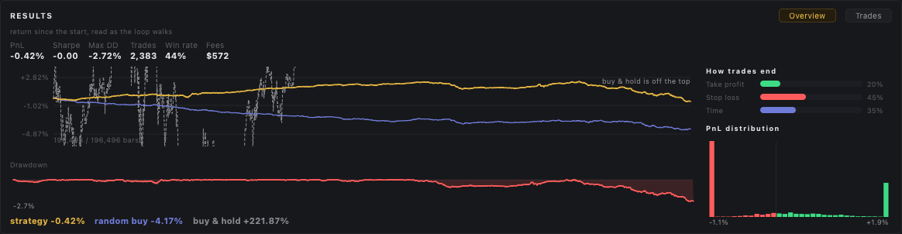

The results tile has **two parts**, picked by the pills in its header.
**Overview** shows the figures (PnL, Sharpe, Max DD, Trades, Win rate, Fees),
the three curves — **strategy** (amber), **random buy** (indigo) and **buy &
hold** (grey dashed) with a running total each in a legend — a **drawdown**
curve under them, and, down the right column, **how trades end** (a bar per
exit — take profit, stop loss, time) with the **PnL distribution** of the trade
returns beneath it. **Trades** is a filterable table —
`Entry · Market · Side · In → Out · Size · PnL · Exit` — with a search box and
side / result / exit filters, and a detail panel for the picked trade: its
entry and exit (time · price), the reason, how long it ran and its fees, its
return, and a little line of the price through the trade. **Picking a row
brings that trade out on the candle chart** — a violet band over the stretch it
held, a line across it, and its entry and exit prices marked. A window of
candles around the trade is read on demand and shown in place of the live
tail, so a trade well before the last candles can be looked at **without
moving the run**. It reads the newest `SHOWN` (400) trades so a long run stays
light.

Everything is drawn as **return from the start**, not as a dollar balance. Over
a long span buy and hold compounds many times over while a strategy that
deploys a fraction of the book per trade barely moves; in dollars the first
flattens the others into the axis. In percent the two strategies stay readable,
and buy and hold is left to run off the top, with its number in the legend and
a note when it does.

Random buy is the benchmark that matters: it opens on a coin flip with the same
exits, sizing and fees, so an entry rule that cannot beat it has no edge. Buy
and hold puts the whole book in at the first bar and never sells.

The curves are sampled **once per tick**, not once per bar — a run can be
millions of bars and the chart cannot use more points than it has pixels.

`Sizing` percentages are a share of what `Max cash $` allows the run to trade
with, not of the whole book: with a $2,000 cap, a 10% position is $200 a
trade.

## Backtest tile

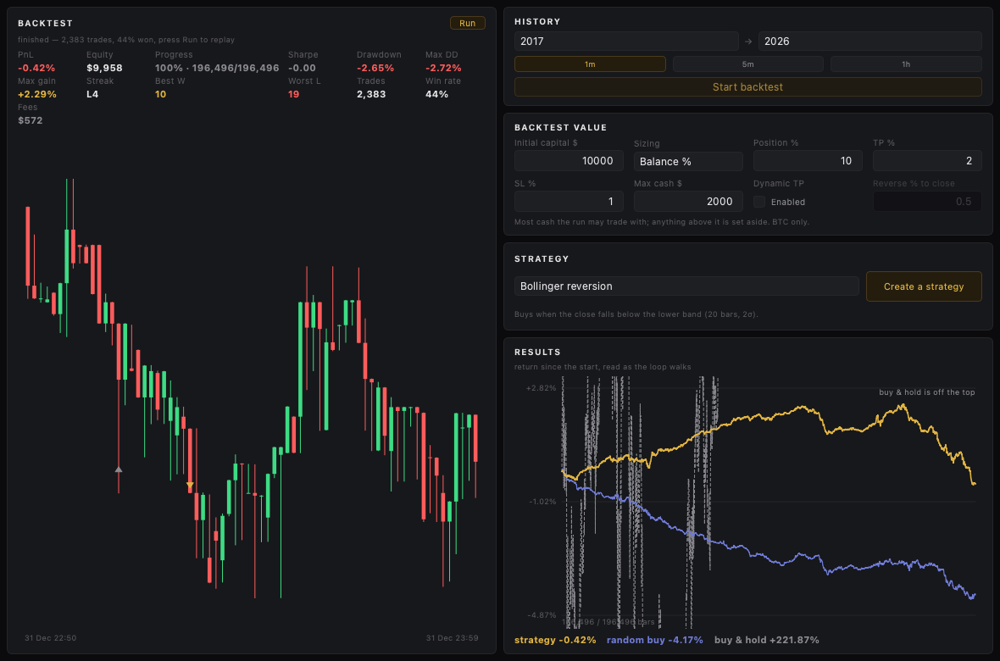

The window is two rows, as in the mock. The **top row** is the run: the
playback panel on the left, and a narrow column on the right stacking the
history controls, the run's inputs and the strategy. The **bottom row** is the
results tile, spanning the full width under both.

Below the history controls sits a gallery of the run's inputs — three or four
to a line, wrapping with the tile's width:

| Field | Meaning |
| --- | --- |
| `Initial capital $` | the book the run starts with |
| `Sizing` | how `Position` is read: `Balance %`, `Fixed $` or `Risk %` |
| `Position` | the value itself; its caption and its bounds follow `Sizing` |
| `TP %` / `SL %` | take profit and stop loss, percent from entry |
| `Max cash $` | most cash the run may trade with; anything above it is set aside |
| `Fee %` | commission each way, percent of the notional |
| `Dynamic TP` | switch: let the take profit trail |
| `Reverse % to close` | pull-back from the peak that closes a trailing TP; only live while the switch is on |

Only BTC is in scope. The starting values live in the same
`~/.config/lalala/settings.json`, under `backtest` (or `LALALA_BACKTEST_*`),
and are clamped on the way in — an unknown `sizing` mode falls back to
`balance`. Numeric fields take a dot as the decimal mark whatever the system
locale, and are bounded so a percentage cannot exceed the whole book.

The right column's tiles **share its whole height** — the inputs take the most,
the small tiles the least — so they always fill it and never scroll. The
results tile spans the window's full width below.

Decided and hard-coded for the run (no switches in the UI): fees and slippage
are fixed, one position is held at a time, and a trade is refused across a
data gap rather than filled through it.

The **strategy tile** picks the entry rule: the two built-ins (**Random buy**,
the baseline, and **Bollinger reversion**), then every **saved strategy** from
`strategies.json`. Picking a saved one points the run at its entry rule — the
rule is checked over the whole span and the walk opens on the bars it fires on
(exits stay the params' TP / SL / hold). **SAVE RUN** keeps the run under a
name — the span, resolution, parameters, strategy and every trade, in
`~/.config/lalala/runs.json` (`LALALA_RUNS` overrides it) — and **LOAD RUN**
opens one again: the controls are set back and the run is **walked straight to
the end**, so every result and trade is there at once.

The bar loop has a **native core** in Rust (`rust/lalala_core`, a PyO3
extension wrapped by `lalala.core`). A span small enough to hold in memory
(≤ `CORE_MAX`, 1.5M bars) is loaded and its entries worked out up front, so the
walk and every seek are a slice plus one native pass — **Finish** and a jump
are instant. A longer span is streamed off disk and stepped in Python. When the
extension is not built, `lalala.core` falls back to the same walk in Python, so
nothing depends on it. Build it with:
`uv run maturin develop --release --manifest-path rust/lalala_core/Cargo.toml`.

## Playback tile

The left half holds the run as a moving picture: bare candles scroll past a
playhead while a row of figures above recomputes on every candle — PnL,
equity, Sharpe, drawdown, max drawdown, max gain, the current streak, the best
winning and worst losing streak, trades, win rate, fees.

Its header carries **Restart**, a **speed** picker (`×1 ×2 ×4 ×8`), and the
**Run** button, which turns into **Pause** while the walk plays (then
**Resume**, and back to **Run** once it is spent). Under the header a **progress
bar** and its readout count the candles — `100% · 196,496 / 196,496 candles`.
The trail always follows the newest candle; a trade picked in the results
rewinds the walk to it so it is on screen.

- **Equity is realised only.** An open position is carried at what it cost, so
  entering a trade moves nothing but its fee; the result lands when it closes.
  Unrealised profit is deliberately not shown.
- **Sharpe is not annualised** — the walk is minutes long, so multiplying by
  the square root of a year would produce a meaningless number. It is the mean
  over deviation of the per-bar book returns.
- **The marks**: an amber ▲ under a candle is an entry, a grey ▼ above one is
  an exit.
- **It stops at the end** of its series rather than looping, and says how the
  run finished. Starting over is a button, never automatic.

**What the loop covers.** The **whole selected span**, streamed off disk bar by
bar — never loaded into memory. A decade of one-minute bars is 4.8M rows and
about 240 MB; holding them as objects would cost far more than the walk does,
so only what the picture and the figures need is kept: a rolling window of the
last `CHART_BARS` (600) bars, the most recent entries and exits, and running
totals. The Sharpe is a running mean and variance rather than a stored series.
Peak memory for a full 2017–2026 walk is around 60 MB.

**It fast-forwards.** A run over any amount of data is watched in about
`WATCH_MS` (two minutes): `stride` bars are consumed per tick, so a few hundred
bars play one at a time and a decade of minutes advances in jumps. The note
says which — `fast-forward ×2,017`. Bar-by-bar over ten years of minutes would
otherwise take about two and a half days to watch.

A span with nothing on disk falls back to a fixed-seed sample and says so.

Fills are the optimistic kind — the target and the stop are both read off one
candle's range, so a candle that touches both pays the target.

Nothing runs when the window opens: the tile sits idle until **Run** (in its
header) or **Start backtest** (in the history tile) is pressed. A change of
span, resolution, strategy or parameter is only remembered — the walk keeps
its place and the note says what is ready — so those buttons are the only
thing that starts a run over.

## Window layout

```
+-------------------------------------------------------------+
|        Volume  Bollinger                       HL ● 210 ms  |
+-------------------------+-----------------------------------+
|                         |  HYPE                       84.6  |
|                         |  1m 3m 5m 15m 30m 1h              |
|                         |  |╿╽│╿╽ ...              │ 85.3   |
|                         |  |╿╽│╿╽                  │        |
|        Polymarket       +-----------------------------------+
|  UP 64.5¢  DOWN 35.5¢   |  xyz:CL  [XYZ]               96.7 +|
|  19:35–19:40  closes…   |  1m 3m 5m 15m 30m 1h              |
|  PM DELAY ● 26 ms       |  |╿╽│╿╽ ...                       |
|  BTC chart + tape       |                                   |
+-------------------------+-----------------------------------+
```

Palette (`theme.py`):

| Token | Hex | Role |
| --- | --- | --- |
| `CANVAS` | `#0b0b0d` | main window, darkest |
| `PANEL` | `#17181b` | floating cards, a shade lighter |
| `BORDER` | `#25262a` | card edge |
| `ACCENT` | `#e0b341` | amber accent, last-price line |
| `UP` / `DOWN` | `#3ddc84` / `#ff5c5c` | candles, latency colours, Polymarket sides |

## Tuning the chart

The feel of the Polymarket chart comes from `~/.config/lalala/settings.json`,
written on first launch. Point `LALALA_SETTINGS` elsewhere to keep a different
profile, or override any key with `LALALA_<KEY>`. Restart after an edit; the
file is read once at startup.

| Key | Default | Effect |
| --- | --- | --- |
| `view_ms` | `900000` | total span on screen (fifteen minutes) |
| `focus_ms` | `130000` | length of the fast live slice |
| `focus_share` | `0.85` | share of the plot width that slice gets |
| `lag_ms` | `1500` | how far behind live the tip sits; must exceed `sample_every_ms` |
| `sample_every_ms` | `1000` | resolution of the stored line |
| `smooth` | `0.30` | per-sample damping; lower is rounder |
| `ease_tip` | `0.18` | per-frame glide toward the target |
| `ease_range` | `0.08` | per-frame glide of the y-scale |
| `frame_ms` | `33` | repaint interval (~30 fps) |

The live edge travels `width × focus_share ÷ (focus_ms / 1000)` pixels a second
— about 3.8 px/s on a wide column, 2.0 px/s on a narrow one. Every value is
clamped to a drawable range, and a corrupt file falls back to the defaults
instead of refusing to start.

## Data sources

Public endpoints only, no key, no signing:

- `POST /info {"type":"meta"}` and `{"type":"meta","dex":"xyz"}` — universe
- `wss://api.hyperliquid.xyz/ws` — `allMids` (main + `xyz`) and WS ping/pong.
  A `bbo` subscription for BTC feeds the Polymarket panel's live price; it
  moves far more often than `allMids` on a quiet market.
- `wss://api.hyperliquid.xyz/ws` `candle` — one subscription per (coin,
  interval) on screen, pushed on every trade. No polling.
- `POST /info {"type":"candleSnapshot", ...}` — initial history for a newly
  watched (coin, interval) pair, plus a 60s reconcile. Polling this every second
  drew HTTP 429s, which is why the stream carries the live updates. The same
  endpoint, with `interval: "1m"`, supplies the Polymarket window's target
  and the line's backfill once per five-minute rollover.

Reconnects with exponential backoff (1s → 10s) and re-subscribes on reconnect.

Polymarket, also public:
- `GET https://gamma-api.polymarket.com/markets?slug=…` — one market per
  five-minute window: question, condition id, two CLOB token ids, prices,
  liquidity, tick size, close time.
- `GET https://clob.polymarket.com/book?token_id=…` — a full book for each
  outcome token, before the stream starts.
- `wss://ws-subscriptions-clob.polymarket.com/ws/market` — one subscription to
  both tokens; `book`, `price_change` and `last_trade_price` frames. The socket
  is dropped at the window boundary and reopened on the next slug.

## Logging

Silent by design. The app is a GUI, so anything writing to the terminal it was
launched from scribbles over work in progress — a stray `print`, a logging
handler on stderr, or Qt's own chatter. `logs.py` points the root logger at a
rotating file and routes Qt's messages into it too, so the process stays quiet.

| Variable | Effect |
| --- | --- |
| `LALALA_LOG` | path to the file (`~/.local/share/lalala/lalala.log`) |
| `LALALA_LOG=off` | no file at all |
| `LALALA_LOG_LEVEL` | `DEBUG`, `INFO` (default), `WARNING`, `ERROR` |

The file rotates at a megabyte, keeping three. `httpx`, `websockets` and
`asyncio` are held at `WARNING` unless the level is `DEBUG`, because their
output at `INFO` is rarely what is wanted. A second `setup()` is a no-op rather
than a second handler, and any console handler a library installed first is
dropped.

## Not implemented yet

- The strategy builder window. It launches on its own and divides into three
  locked columns: the two rules tiles check a formula but nothing defines or
  runs one yet, and nothing in the backtest window opens it.
- Order entry. `venues/hyperliquid.py` can sign and submit, but nothing in the
  UI calls it — deliberately, and it needs a key.
- Account balance / positions.
- Polymarket order entry. The column reads the market live; nothing places an
  order, and `PolymarketVenue.balances()` still raises with the endpoint it
  needs.
- Volume/hover readouts on the chart; candles are OHLC only.
- `l2Book` support still exists in `feed.py` (tested) but no widget subscribes
  to it any more, since the order book was replaced by candles.
