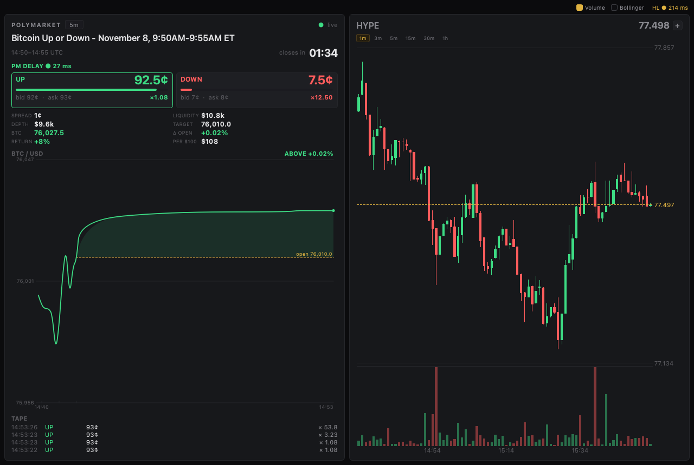

# bi-trading

Dark trading terminal and backtester. Hyperliquid candles are live on the
right; the left column tracks the current Polymarket five-minute BTC up/down
market. A strategy builder and a backtest engine live in the same app, and the
Polymarket side backtests bets on the real past five-minute markets.



## Quick start

```sh
uv sync                  # PySide6, httpx, websockets, numpy, pyarrow
uv run bi-trading        # the whole app, the hub: Home, Live, Builder, Backtest, Settings
```

The GUI opens with no credentials, network access or wallet keys. Optional
extras:

```sh
uv sync --extra venues                  # Hyperliquid / Polymarket SDKs, to place orders
uv sync --extra native                  # the Rust backtest walk (needs a Rust toolchain)
uv sync --extra venues --extra native   # both; `uv sync` is exact, so name every extra
```

The app launches as a whole; there is one command, `bi-trading` (also `python -m bi_trading`).

## Orders are dry-run by default

Buy / Sell and the Polymarket bet buttons only keep a paper position until you
turn on **Place real orders** in Settings → Trading defaults *and* the venue is
connected. Even then an order waits for a confirm dialog and is capped by the
max stake. Private keys live in the macOS Keychain, never in `settings.json`.
Details: [docs/configuration.md](docs/configuration.md).

## What's inside

| Area | What it is | Details |
| --- | --- | --- |
| Terminal | Live candle cards, overlays, search over 377 markets, the Polymarket 5m column | [docs/terminal.md](docs/terminal.md) |
| Strategy builder | Drag-and-drop formula builder, rules, code view, saved strategies; on Polymarket three rules (bet UP, bet DOWN, cash out) | [docs/strategy-builder.md](docs/strategy-builder.md) |
| Formulas | The entry/exit formula language and its evaluator | [docs/formulas.md](docs/formulas.md) |
| Backtest | Candle store and download, run controls, results, playback | [docs/backtest.md](docs/backtest.md) |
| Polymarket backtest | The Backtest view on the Polymarket venue: bet UP or DOWN on past five-minute markets with real downloaded prices (a simulated fair price where none exists), cash out early or settle; rules mix Binance candles with `up_price`, `down_price`, `minute`, `seconds_left` | [docs/polymarket-backtest.md](docs/polymarket-backtest.md) |
| Logs | The trading record: orders, fills, signals, warnings, with the why | [docs/logs.md](docs/logs.md) |
| Configuration | Settings, trading safety, saved state, logging | [docs/configuration.md](docs/configuration.md) |
| Architecture | Why Python, source layout, data sources | [docs/architecture.md](docs/architecture.md) |

Open work is tracked in [TODO.md](TODO.md).

## Develop

```sh
uv run ruff check src tests
uv run mypy                         # the whole tree, Qt modules included
uv run pytest -q -n auto            # headless: no network, no sockets
UPDATE_GOLDEN=1 uv run pytest tests/test_visual.py   # redraw the screenshot goldens
uv run python tools/screenshots.py  # regenerate docs/images offscreen
```

Layout in one line: `src/bi_trading/` holds `data/` (feeds and candle store),
`engine/` (the Qt-free backtest), `state/` (settings, orders, runs),
`ui/` (everything Qt) and `venues/` (order adapters); `rust/bi_trading_core/`
is the optional native walk.
