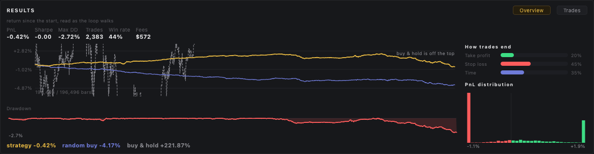
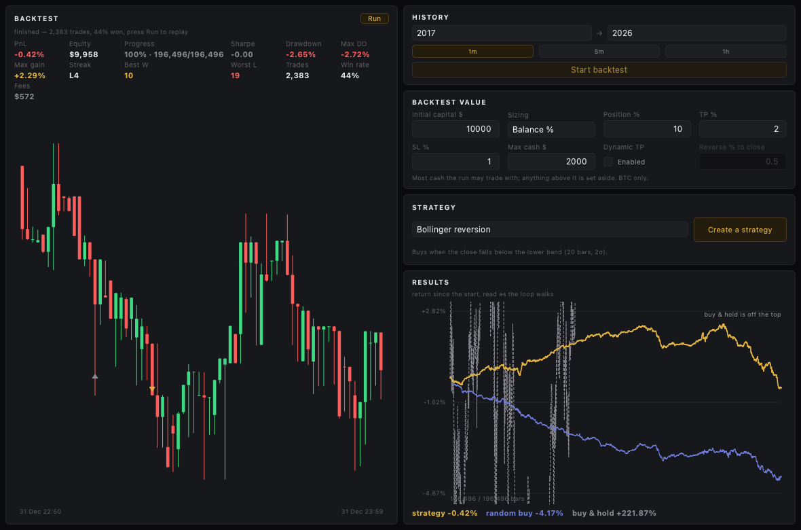

# Backtest

The backtest window: results, run controls, playback and layout. Back to the [README](../README.md).

## Results tile



The results tile has **two parts**, picked by the pills in its header.
**Overview** shows the figures (PnL, Sharpe, Max DD, Trades, Win rate, Fees),
the three curves — **strategy** (amber), **random buy** (indigo) and **buy &
hold** (grey dashed) with a running total each in a legend — a **drawdown**
curve under them, and, down the right column, **how trades end** (a bar per
exit — take profit, stop loss, time) with the **PnL distribution** of the trade
returns beneath it. **Trades** is a filterable table —
`Entry · Market · Side · In → Out · Size · PnL · Exit` — with a search box and
side / result / exit filters, and a detail panel for the picked trade: its
entry and exit (time · price), the reason, how long it ran and its fees, its
return, and a little line of the price through the trade. **Picking a row
brings that trade out on the candle chart** — a violet band over the stretch it
held, a line across it, and its entry and exit prices marked. A window of
candles around the trade is read on demand and shown in place of the live
tail, so a trade well before the last candles can be looked at **without
moving the run**. It reads the newest `SHOWN` (400) trades so a long run stays
light. The detail panel draws the trade's **real candles** (a few bars before the entry to
a few after the exit, the entry and exit marked), read from the store on demand; a sample
run, with nothing on disk, falls back to a line. Every row of the table also carries a small
strip of its own candles beside its prices (a trade longer than 32 bars is squeezed to 32); a
year is read once however many trades fall in it, and kept (three at a time), so filtering or
picking a trade does not read it again. **Export CSV** writes *every* trade of the
run, not just the 400 shown (times in UTC).

The third part, **Compare**, is the builder's compare page fed from the run: the rule
over the last 2,000 bars against a random buy and buy & hold, a TP × SL sweep and a
walk-forward, with the saved strategies addable. It needs an entry rule, so Bollinger
reversion or a saved strategy; the random baseline has none and it says so.

Everything is drawn as **return from the start**, not as a dollar balance. Over
a long span buy and hold compounds many times over while a strategy that
deploys a fraction of the book per trade barely moves; in dollars the first
flattens the others into the axis. In percent the two strategies stay readable,
and buy and hold is left to run off the top, with its number in the legend and
a note when it does.

Random buy is the benchmark that matters: it opens on a coin flip with the same
exits, sizing and fees, so an entry rule that cannot beat it has no edge. Buy
and hold puts in what `Max cash` lets the run trade with (not the whole book), pays
the same fee and slippage once on the way in, keeps the rest in cash and never
sells, so it risks the same money as the strategy and costs the same.

Under the six figures a second row reads **what one trade is worth**, all off the trade
log: **Expectancy** (the average trade, as a return and in dollars), **Avg hold** (bars),
**Exposure** (the share of bars with a position open), **Profit factor** (what the winners
made over what the losers lost) and **Sortino** (the average trade over its downside
deviation — losing trades only; per trade and not annualised, unlike the Sharpe, which is
per bar). Profit factor and Sortino read `—` while there is no losing trade. PnL stays the
headline; Expectancy is the one to read next, because it says whether the edge is per trade
or a few lucky ones. (`engine/stats.py`.)

Two small lines sit under those figures once a run has trades, and say how far to trust
them (`engine/stats.py`, shown only when there is something to say):

- **Risk on a yearly footing:** Sharpe per year and Calmar (yearly return over the deepest
  drawdown), for spans of at least 30 days (a yearly rate from a few days is a number about
  nothing), and the **longest time under water** in bars and days. They assume BTC trades
  every minute of the year.
- **Doubt on the average trade:** a per-trade Sharpe (the same basis as the Sortino), the
  t-stat of the average trade, its two-sided p-value and 95% interval, and a warning under
  30 trades. They assume the trades are independent, which a rule that fires in clusters
  breaks, so they are a floor on the doubt, not a proof of an edge.
- **Costs:** the PnL at these costs and at 2x fees and slippage. A first-order estimate from
  the trade log (each trade's fees and slippage doubled, later sizes not re-worked), not a
  second run.
- **By year:** trades, profit and win rate for each year the trades closed in.

The curves are sampled **once per tick**, not once per bar — a run can be
millions of bars and the chart cannot use more points than it has pixels.

`Sizing` percentages are a share of what `Max cash $` allows the run to trade
with, not of the whole book: with a $2,000 cap, a 10% position is $200 a
trade.

## What this backtest is not

It simulates a **spot-style position on BTC candles**: a market entry at the close of
the signal bar, a take profit, a stop loss, an optional trail, a hold limit, a flat fee
and a flat slippage per side. The history is Binance BTCUSDT. Read every figure with
that in mind. It does **not** model:

- **Polymarket 5-minute markets.** Those are binary: a share costs the ask, pays 1 if
  the window ends on the right side and 0 otherwise, and the edge is the model's
  probability minus the ask. The backtest has no market price, so `min edge` is not
  applied and a Polymarket strategy cannot be validated here. Test those in paper mode.
- **Hyperliquid perps.** No funding, leverage, margin or liquidation.
- **A different venue's candles.** Spreads, wicks and fills on the venue you trade
  differ from Binance spot, most on 1m bars.
- **Queue position or trade-through.** A take profit fills at its price on any touch;
  a stop fills at its price even if the bar gapped past it; the entry fills at the
  signal bar's close.

The ML builder's own test-set simulator (`rule_stats` in `ml/train.py`) is separate from
the walk: it does not apply the data-gap rule or the volume cap. Use a backtest of the
saved strategy for the figure that counts.

The full list of weaknesses, by importance, is in [backtest-audit.md](backtest-audit.md).

## Backtest tile



The window is two rows, as in the mock. The **top row** is the run: the
playback panel on the left, and a narrow column on the right stacking the
history controls, the run's inputs and the strategy. The **bottom row** is the
results tile, spanning the full width under both.

Below the history controls sits a gallery of the run's inputs — three or four
to a line, wrapping with the tile's width:

| Field | Meaning |
| --- | --- |
| `Initial capital $` | the book the run starts with |
| `Sizing` | how `Position` is read: `Balance %`, `Fixed $` or `Risk %` |
| `Position` | the value itself; its caption and its bounds follow `Sizing` |
| `TP %` / `SL %` | take profit and stop loss, percent from entry |
| `Max cash $` | most cash the run may trade with; anything above it is set aside |
| `Fee %` | commission each way, percent of the notional |
| `Dynamic TP` | switch: let the take profit trail |
| `Reverse % to close` | pull-back from the peak that closes a trailing TP; only live while the switch is on |

Only BTC is in scope. The starting values live in the same
`~/.config/bi-trading/settings.json`, under `backtest` (or `BI_TRADING_BACKTEST_*`),
and are clamped on the way in — an unknown `sizing` mode falls back to
`balance`. Numeric fields take a dot as the decimal mark whatever the system
locale, and are bounded so a percentage cannot exceed the whole book.

The right column's tiles **share its whole height** (when the window is shorter than
the tiles need, about 600px, the column scrolls instead of squeezing them) — the inputs take the most,
the small tiles the least — so they always fill it and never scroll. The
results tile spans the window's full width below.

Decided and hard-coded for the run: one position is held at a time, and a trade
is never held through a hole in the data. A hole is two neighbouring bars more than
one step apart (an exchange outage, a missing year). The walk closes an open position
at the close of the last bar before the hole, as a market exit that slips like any
other and reads `Data gap` in the results, and opens nothing on that bar. The baseline
follows the same rule. It is the same in the native core, the Python fallback, the
walk in pieces and the stepped playback.

**Bars on the clock.** A 3m / 5m / 15m / 30m / 1h bar covers the minutes from a multiple
of its length (a 5m bar opens at :00, :05, ...), built from its own minutes. A bar with
any minute missing is dropped, not drawn from fewer, so after an outage the later bars
stay on the grid and the hole shows up as a hole. Bars never span two year files.

**Slippage** is what a market fill gives away, per side, in percent (the
*Slippage %* parameter, `slippage` in the settings file; 0.01 by default). An
entry fills that much worse than the close it was decided on — higher for a
long, lower for a short — and every exit slips against the trade, except the
take profit, which is a resting limit order and fills at its price. The fee is
charged on top. The builder's previews use the same 0.01%.

**Venue costs.** The *Venue costs* pick fills the fee and the slippage with a
venue's own (Hyperliquid 0.045% + 0.01%, Polymarket 0% + 0% to start); typing
either by hand leaves it on *Custom*. The presets live under `backtest.venues`
in the settings file, a `{"fee", "slippage"}` pair per venue in percent, and
are starting points to edit, not quotes — Polymarket's cost depends on the
market. The Fees figure in the results shows the rates on hover.

**Warm-up.** *Warm-up (bars)* (`warmup` in the settings file) is how much
history must exist before a signal counts, so indicators have settled. It is
**100 by default** (0 turns it off; a settings file that already says 0 keeps 0). The first N bars never open a trade, for the
strategy and for the random baseline alike. The live strategy bar uses the same
setting: while the chart holds fewer than N bars its signal reads `WARM-UP`
instead of firing. The builder's previews do not use it.

**Volume cap.** An entry takes at most a share of what the entry bar traded
(`participation` under `backtest` in the settings file, percent of volume times close;
1 by default, 0 turns it off). BTC minutes trade far more than the default cash, so it
rarely binds; it stops a large size from filling in a thin bar. It has no field on the
tile. Not modelled: minimum lot, tick rounding, and market impact beyond the flat slippage.

**Sanity clamps.** A max cash above the capital, or a fixed dollar position
above it, is brought back to the capital, and a reverse % with the dynamic take
profit off is ignored; the playback note says when one applied.

A trade ends at the first of: its **stop**, its **take profit**, the strategy's
**exit rule**, or the **hold limit** — by default **7 candles** (the *Hold
(candles)* parameter, `hold` in the settings file; 0 means no limit). When one
candle reaches both the stop and the take profit, the candle cannot say which
came first, so the **stop is booked**.

The **strategy tile** picks the entry rule: the two built-ins (**Random buy**,
the baseline, and **Bollinger reversion**), then every **saved strategy** from
`strategies.json`. Picking a saved one points the run at its entry rule — the
rule is checked over the whole span and the walk opens on the bars it fires on
and so does its **exit rule**, checked at each bar's close while a trade is
open, after the params' take profit and stop loss (which still act inside the
bar) and before the hold limit; a trade it closes reads `Rule`. A saved
strategy's side is honoured too. **Edit rules**, under the strategy picker, changes a saved strategy's entry and exit rule
in place (checked by the builder's parser as you type) and points the run at it; the
**Create a strategy** button opens the builder. **Rename**, under the run picker, gives a
saved run another name, trades and curves kept. A run carries *a copy* of its strategy's
rules (name, entry, short entry, exit, side), so it replays the same even if the saved
strategy is edited later: the entry rule is both a field of the run and a named,
separately saved strategy. **SAVE RUN** keeps the run under a name: the
span, resolution, parameters, the strategy (name, entry, short entry, exit, side), and what
it produced. The small facts go in `~/.config/bi-trading/runs.json`
(`BI_TRADING_RUNS` overrides it); the trades and both equity curves go in Parquet
files in `runs_data/` beside it, so the index stays a few kilobytes. An older
`runs.json` with its trades inline is migrated on first read (the original is
kept as `runs.json.bak`). **LOAD RUN** opens one again: the controls are set
back, including the saved strategy's exit and side, and the run's own stored
trades and curves go straight back on screen, so every result and trade is
there at once with no walk. Only when they do not fit the span (another
length, or no trades stored) is it walked again, on a worker thread.

**Overlay.** *Overlay*, under the run picker, lays a saved run's strategy curve over
the current one — a teal dash-dot line with its own legend entry
(`overlay: <name> +x.xx%`) — so two runs, or the same strategy under two sets of
parameters, can be read together. Both are drawn as return from their own start and
stretched to the same width, so runs of different lengths compare by how far
through each one is; the scale widens to fit the overlay. Picking another run
moves it; *Remove overlay* takes it off. A run saved without curves says so
instead.

The bar loop has a **native core** in Rust (`rust/bi_trading_core`, a PyO3
extension wrapped by `bi_trading.engine.core`). A span small enough to hold in memory
(≤ `CORE_MAX`, 12M bars) is loaded and its entries worked out up front, so the
walk and every seek are a slice plus one native pass — **Finish** and a jump
are instant. The native pass does everything the Python one does: long and
short, both ways at once, risk sizing, the trailing take profit, and the exit
rule, which is compiled to a small program the core runs bar by bar
(`compile_exit`). A longer span is **walked in pieces**: read a year at a time, each piece handed to
the same native walk with the book carried over from the last (`walk_chunk`), so a
trade can open in one year and close in the next and the result is the same as one
walk over everything. The running figures (peak, drawdown, Sharpe) are accumulated
piece by piece, the curves keep one point a tick, and only the last bars are kept for
the picture, so memory stays flat however long the span. Finish and a jump work on
such a span as they do on a short one, off the main thread. This covers the built-in
rules and **formula strategies** too: a rule made of the bar's own columns and the
indicators (`sma`, `ema`, `rsi`, `highest`, `lowest`, `stdev`, `zscore`, `change`, `shift`,
the Bollinger bands, and the arithmetic around them) is worked out a piece at a time,
each indicator lent what it needs from the piece before — the tail of its own input for
a window, the running values for `ema` and `rsi` — so the signals are exactly the ones a
whole pass gives (`SignalStream` in `engine/formula_eval.py`). Tested equal to the whole
walk on a decade of minutes (same trades, same figures), and faster than loading the span
whole. A rule that names something with no history on disk (`model_p`, `spread`…), or a
span with a gap, loads whole as before. (`model_p` is filled from the strategy's saved ML
model when it has one; see [ml.md](ml.md).) Run on a formula strategy over a span this long
walks it in pieces instead of playing it bar by bar; a built-in rule that is only played
still steps in Python. When the
extension is not built, `bi_trading.engine.core` falls back to the same walk in Python, so
nothing depends on it. Build and install it with `uv sync --extra native`
(uv rebuilds it when `rust/bi_trading_core/src` changes).

## Playback tile

The left half holds the run as a moving picture: bare candles scroll past a
playhead while a row of figures above recomputes on every candle — PnL,
equity, Sharpe, drawdown, max drawdown, max gain, the current streak, the best
winning and worst losing streak, trades, win rate, fees.

Its header carries **Restart**, a **speed** picker (`×1 ×2 ×4 ×8`), and the
**Run** button, which turns into **Pause** while the walk plays (then
**Resume**, and back to **Run** once it is spent). Under the header a **progress
bar** and its readout count the candles — `100% · 196,496 / 196,496 candles`.
The trail always follows the newest candle; a trade picked in the results
rewinds the walk to it so it is on screen.

- **Equity is marked to market.** An open long is worth its quantity at the
  latest close; an open short its margin plus what the price has fallen. So an
  open loss counts towards drawdown, and the stepped figures and the walk's
  curve agree.
- **Sharpe here is per bar** — the mean over deviation of the per-bar book returns, as
  a walk of a few minutes would give. The results tile also shows a yearly Sharpe once the
  span is a month or more.
- **The marks**: an amber ▲ under a candle is an entry, a grey ▼ above one is
  an exit.
- **It stops at the end** of its series rather than looping, and says how the
  run finished. Starting over is a button, never automatic.

**What the loop covers.** The **whole selected span**, streamed off disk bar by
bar — never loaded into memory. A decade of one-minute bars is 4.8M rows and
about 240 MB; holding them as objects would cost far more than the walk does,
so only what the picture and the figures need is kept: a rolling window of the
last `CHART_BARS` (600) bars, the most recent entries and exits, and running
totals. The Sharpe is a running mean and variance rather than a stored series.
Peak memory for a full 2017–2026 walk is around 60 MB.

**It fast-forwards.** A run over any amount of data is watched in about
`WATCH_MS` (two minutes): `stride` bars are consumed per tick, so a few hundred
bars play one at a time and a decade of minutes advances in jumps. The note
says which — `fast-forward ×2,017`. Bar-by-bar over ten years of minutes would
otherwise take about two and a half days to watch.

A span with nothing on disk falls back to a fixed-seed sample and says so.

Fills are the optimistic kind in other ways (see **What this backtest is not**):
the target and the stop are read off one candle's range. When one candle touches
both, the stop is booked, as in the run controls above.

Nothing runs when the window opens: the tile sits idle until **Run** (in its
header) or **Start backtest** (in the history tile) is pressed. A change of
span, resolution, strategy or parameter is only remembered — the walk keeps
its place and the note says what is ready — so those buttons are the only
thing that starts a run over.

## Window layout

```
+-------------------------------------------------------------+
|        Volume  Bollinger                       HL ● 210 ms  |
+-------------------------+-----------------------------------+
|                         |  HYPE                       84.6  |
|                         |  1m 3m 5m 15m 30m 1h              |
|                         |  |╿╽│╿╽ ...              │ 85.3   |
|                         |  |╿╽│╿╽                  │        |
|        Polymarket       +-----------------------------------+
|  UP 64.5¢  DOWN 35.5¢   |  xyz:CL  [XYZ]               96.7 +|
|  19:35–19:40  closes…   |  1m 3m 5m 15m 30m 1h              |
|  PM DELAY ● 26 ms       |  |╿╽│╿╽ ...                       |
|  BTC chart + tape       |                                   |
+-------------------------+-----------------------------------+
```

Palette (`theme.py`):

| Token | Hex | Role |
| --- | --- | --- |
| `CANVAS` | `#0b0b0d` | main window, darkest |
| `PANEL` | `#17181b` | floating cards, a shade lighter |
| `BORDER` | `#25262a` | card edge |
| `ACCENT` | `#e0b341` | amber accent, last-price line |
| `UP` / `DOWN` | `#3ddc84` / `#ff5c5c` | candles, latency colours, Polymarket sides |
