# Strategy builder

Building, saving and checking a strategy. Back to the [README](../README.md).

## Strategy tile

The entry rule the run is pointed at, with a **Create a strategy** button on
the right. The button is still a placeholder and opens nothing; the builder
window it will open is the hub's Builder view. Two rules so
far:

| Rule | What it does |
| --- | --- |
| `Random buy` | opens on a coin flip (3% of flat bars). Kept in the list on purpose: it is the baseline an entry rule has to beat, not a fallback. |
| `Bollinger reversion` | buys when the close falls below the lower band of a 20-bar, 2σ channel. |

Like the span and the parameters, a change here is only remembered until
**Run** / **Start backtest** is pressed.

## Strategy builder

The hub's Builder view (`uv run bi-trading`), not opened by the backtest window and connected to
nothing in it.

Two columns side by side, splitting the width **21 / 79** — a narrow rail on
the left, everything else on the right — separated by the same 8 px gap and
nothing else. The split is **locked**: dragging a handle does nothing, so the
share changes only when the window is resized.

The rail holds the small **STRATEGY** tile on top and the saved-strategies
list under it.
The rest holds one rules tile with the **results** under it, the rule taking
the upper part. The window does not have to fit two rules side by side any
more.

A **footer** spans the bottom of the window, as in the mock: the draft's name
on the left, and `Delete strategy`, `Reset` and `Save` on the right. `Reset`
clears the draft — name, bar and both rules. `Save` writes it to
`~/.config/bi-trading/strategies.json` under its name, replacing an earlier one of
the same name rather than piling up; it needs a name and rules that check out,
and the footer says which is missing. `Delete strategy` is described below.

The **STRATEGY** tile at the top of the rail is
`STRATEGY` and holds one row: a text field (`name` as its placeholder) taking
the slack, and a dropdown of `1m`, `5m`, `15m` and `1h` at its own width,
defaulting to `1m`. It is only as tall as the title and that row.

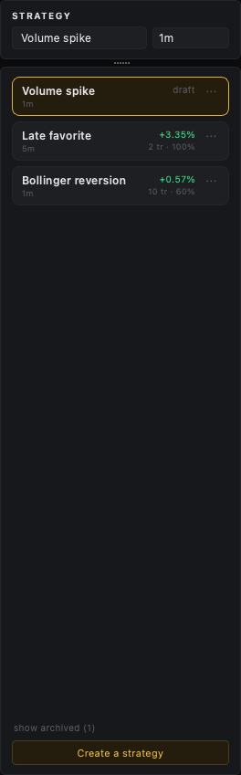

Under it sits the **saved-strategies rail** — one row per kept draft, most
recent first: the **name** on the left and the **return** it made over the same
tail of candles the results tile reads on the right, in the mock's own shape.
The draft you are on is lit; if it is not saved yet it shows at the top badged
`draft`. Clicking a row loads that strategy back into the editor, and
**Create a strategy** starts a fresh draft. The file is
`~/.config/bi-trading/strategies.json` (`BI_TRADING_STRATEGIES` overrides it) — plain
JSON, one object per strategy with its name, bar and both rules as text; a
missing or broken file simply reads as empty.

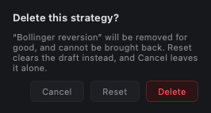

At the bottom, beside `Reset` and `Save`, a **Delete strategy** button sits
quiet until a saved strategy is on show — then it turns red. Pressing it opens
a small prompt: **Delete** removes the strategy from the file and clears the
editor, **Reset** clears the draft but keeps the saved copy, and **Cancel**
leaves both alone.

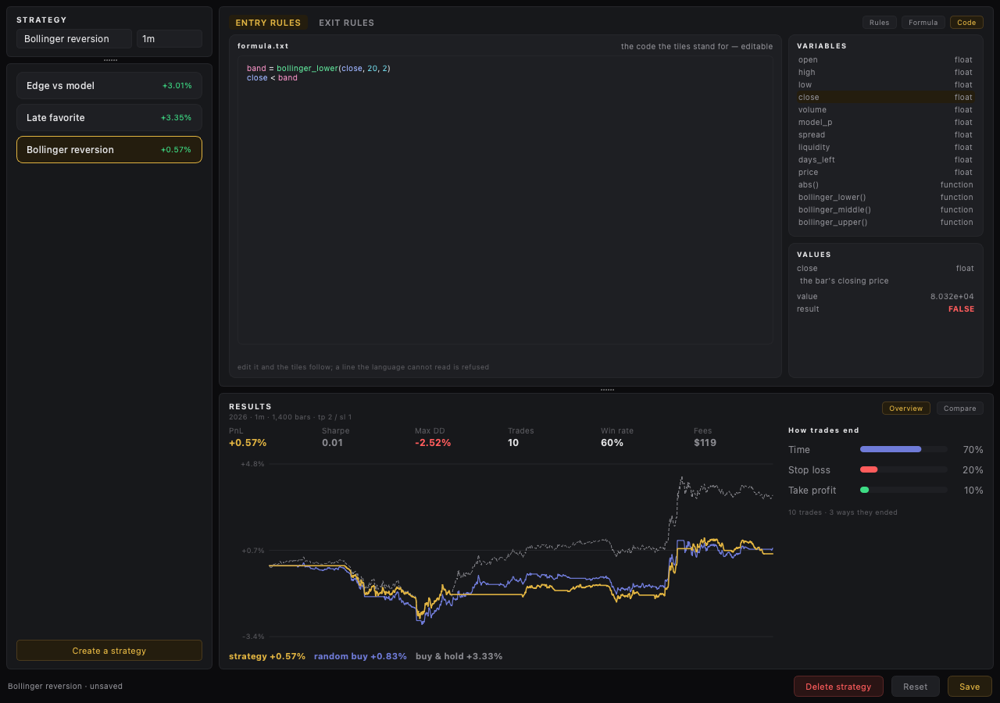

Under it the right-hand column has **one rules tile**, and **ENTRY RULES** /
**EXIT RULES** are the switch at its top: they are the same widget —
`strat_rules.RulesTile` — and `strat_rules.RulesSwitcher` keeps both, showing
one at a time. The `Rules` / `Formula` / `Code` pills beside them belong to
the side on show and follow it when you switch. That way either rule gets the
full width of the tile instead of the two squeezing into it.

Each side has **three tabs** — `Rules`, `Formula`, `Code` — and starts on
`Rules`, the condition editor. A **LET** section on top names series
(`band = bollinger_lower(close, 20, 2)`): `+ Add variable` adds one, and the
name it defines joins the Variables rail below. Then come the conditions,
gathered in dashed **groups**. A group starts with **one cell, active by
default** — the cursor is already in it, ready to fill. The little `+` under
the cells opens three things to add: a **Condition** (an operand, an operator
and a value), a **Math** operator (`* + - / …`) or a **Value** (`2`, `band`).
That is how `volume > sma(volume, 50) * 2` is one condition plus a math cell
and a value cell. Each group joins its terms with **All (AND)** or **Any
(OR)**, and the groups themselves are joined with AND — so several conditions
collect together in the group's dashed box. The rule as a formula is pinned at
the bottom left, with whether the rows make a valid rule and what the newest
bar said.

The **operands and the operator are picked, not typed**. The operator has its
own little list; the operands and values have **no dropdown at all** — a click
leaves the cursor in the box and the **Variables** rail fills it. The rail lists
the fields, the indicators and any name the LET rows define; picking one
**replaces** what is in the focused box. Only the value box takes typed text,
so a number like `0.03` can be written — the only name written free-hand is the
LET variable's own.

A cell's `×` shows **only when it can be deleted**: the sole condition of a
group, or the only group, carries no `×`. (The mock put signal options in the
right rail — side, confirmation bars, cooldown — but the backtest models none
of them.)

`Rules` is another way to write the same formula: it reads any condition that
is a flat AND / OR of comparisons into rows, keeps `name = …` lines as LET
rows, and keeps a condition it cannot break up as one raw expression. `Code` is
canonical both ways: typing it rebuilds the rows and the formula, and the
window re-runs the report. `Formula` is the drag-and-drop builder and `Code`
the same formula as text.

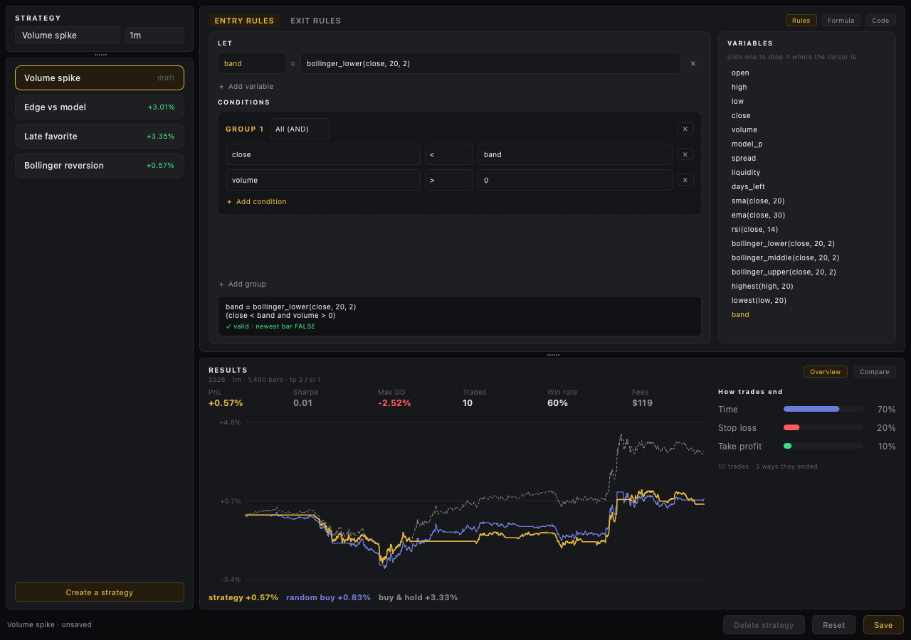

Typing a rule **autofills**: the `Code` editor and the `Formula` tab's value box
offer the fields, the indicators and the functions — `and or not` too — as you
type, and `Tab` / `Enter` takes the suggestion.

The `Formula` and `Code` panels have a natural size of their own and **scroll**
inside the tile rather than making it grow, so a narrow window keeps the rules
where they are and the panel moves under the cursor.

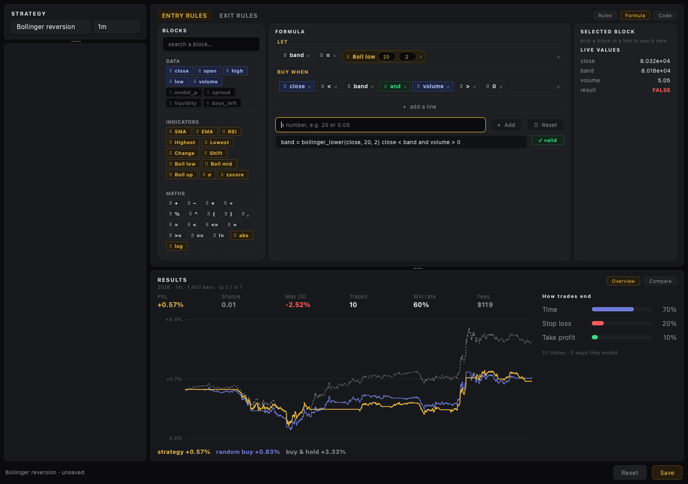

The `Formula` tab is three columns, as in the mock. **Blocks** is the small
left rail (200 px, fixed) — a search box over one dashed group per kind
(`Data`, `Indicators`, `Maths`, `Logic` — boxes, not different colours, so the
list reads as one surface), with **no scrollbar**: the wheel walks the list.
A **`Variables`** group sits above them, listing the names the rule defines, so
a named series can be dragged into the condition like any other block; it is
hidden until something is named.
The **Formula** takes the slack in the middle: the lines sit directly on the
card — no scrollbox of their own, so all of them show at once and the page
around the builder moves if a long rule needs more room — and the formula as
text is one small read-only line that scrolls sideways. The lines are grouped
into subsections: named series sit under **`Variables`**, which is always shown
with its **`+ Add variable`** button — that adds a named line above the
condition. That line is just the small **name field**, the one token you type
by hand (styled like the chips around it), and a fixed `=`; nothing else. Drag
a block onto the line to give it a value. The condition sits under **`BUY
WHEN`** on the entry side and **`EXIT WHEN`** on the exit side. The **Selected block** is
the right rail (a little under 250 px), pushed against the edge and scrolling
in place: its name, source and live values stay readable in a short tile.
Clicking a chip selects it: the card shows its name, its source and its window,
all editable, and under them the live values that name reads on the newest bar,
with the rule's result.

| | |
| --- | --- |
| 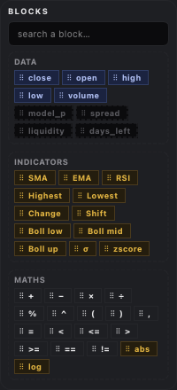 | 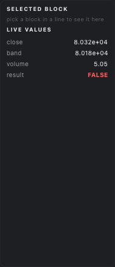 |

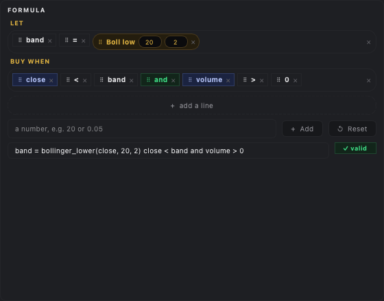

The `Code` tab is the code on the left, with a right rail holding `Variables`,
the whole vocabulary with its types, over `Values`, the last bar's numbers.
The two lists are stacked and **scroll in place**; `Variables` hides its bar so
the names get the width, while the page around them does not scroll, so the
code stays put while you read them. Clicking a word in `Variables` picks it:
the row stays lit and `Values` explains it in a line and shows its number on
the newest bar. The code block and the formula bar share the card's fill, with
only a border to mark them, so the text never sits on a darker patch.

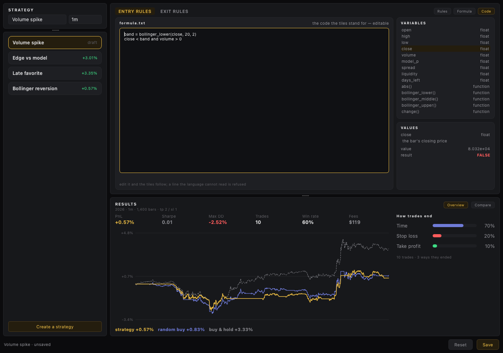

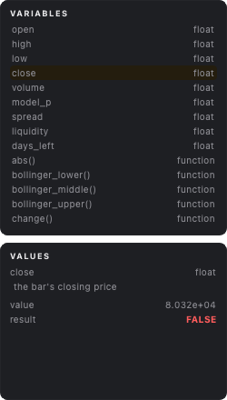

The palette carries the **market words** the mock shows — `model_p`, `spread`,
`liquidity`, `days_left` — beside the bar's own. Nothing here carries them: they
validate so a rule can name them, they evaluate to nothing, and the tile says so
under the rule (`⚠ spread: no history in a backtest`). The indicators gained `σ`
(`stdev`), `zscore`, and maths gained `log`.

The two read **different vocabularies**:

| Tile | May use |
| --- | --- |
| `ENTRY RULES` | the bar — `open high low close volume` — and the indicators |
| `EXIT RULES` | the open trade — `price entry tp sl pnl bars` — and plain maths only |

`pnl`, `tp` and `sl` are percentages; `price` is the close while the trade is
open; `bars` is how long it has been open. An indicator in an exit rule is
refused with `not here, this rule takes no indicators`, and a bar name like
`close` is an unknown name there.

Nothing is saved yet, and nothing is wired to the walk.

### The formula builder

The `Formulas` page is a drag-and-drop builder. A card holds the sources —
three rows of draggable **blocks**, then a box to type a number into:

| Row | Blocks |
| --- | --- |
| `DATA` | `close`, `open`, `high`, `low`, `volume` |
| `INDICATORS` | `SMA`, `EMA`, `RSI`, `Highest`, `Lowest`, `Change`, `Shift`, and the three Bollinger bands — each drops as one tile with its numbers inside |
| `LOGIC & MATHS` | `AND`, `OR`, `NOT`, `=`, parentheses, comma, arithmetic, comparisons |
| number box | type a value, `+ Add` puts it on the active line, `↺ Reset` clears every line |

Each block is a pill with a drag handle, coloured by what it is — data in
indigo, indicators in amber, `AND`/`OR`/`NOT` in green, maths neutral — and
each row wraps when the tile is narrow. The lines live in a scroll area, so
the card keeps its height however many of them there are.

The rules tile takes the column below `STRATEGY`, and either side gets all of
its width.

Under the card are the lines, one strip of chips each, read left to right. They
are split into two subsections: the variables under `LET`, and the last line —
the condition — under `BUY WHEN` (`EXIT WHEN` on the exit side). The `LET`
heading is hidden when there are no variables. A line wraps rather than
clipping, and the card grows to fit them:

```
LET  [band] [=] [Boll low 20 2]
BUY WHEN   [close] [<] [band]
```

An **indicator drops as a single tile** and nothing else comes with it: the
tile holds its own number — one for `SMA`, two for a Bollinger band — so `Boll
low` with `20` and `2` reads as `bollinger_lower(close, 20, 2)`. Edit a number
by typing in the tile; it rewrites the formula as you go.

A chip drags by its handle to reorder or move between lines, and its `×` takes
it off; `+ add a line` adds a line and each line carries its own `×` to remove
it (the last one stays). A drag carries a picture of the block itself, so what
is moving is visible under the cursor, and the line it is over lights up as the
drop target. Long lines **wrap** rather than clipping. A blank run shows a
dashed `drag a block here`, and a live pill reads `✓ valid`, `✗ not valid` or
`— empty`.

The chips are only an editor. The formula **text** is the truth: it is rebuilt
from the chips and handed to `bi_trading.engine.formula.parse`, so the same checker still
reports `line 2, column 9: unknown name 'clsoe'`, and the text is what a run
would use.

### The code view

`Code` is the same formula as text in a monospace editor. It is filled from the
tiles, and it can be typed in directly: whatever is written there is scanned,
checked, and rebuilt into tiles, so the two views never disagree. A name that
was never defined is flagged with its place, and defining it on a line above
clears it — the same rules the language has always had.

A line the language cannot even read — a stray character like `@` — is
**refused**: the previous code is put back and the reason is shown, rather than
leaving the tiles and the code out of step.

Reading text back keeps indicators whole: `bollinger_lower(close, 20, 2)` comes
back as one tile holding `20` and `2`, not a run of separate chips.

### Results tile

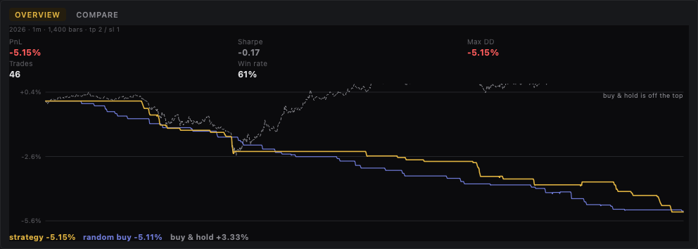

The tile keeps its `RESULTS` title, with the span under it, and **two
subwindows** as pills on the right — `Overview` and `Compare` — the way
`Rules` / `Formula` / `Code` sit in the rules tile. Only one is on show at a
time; `Overview` is the default.

`Overview` is a **split**: on the left the six figures in one row, then the
curve under them; on the right a rail listing **how the trades ended**, one bar
per reason, most-appearing first.

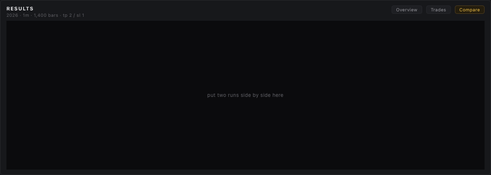

`Compare` puts the run beside its two stand-ins, from the same tail of candles:

- a row of **runs** — `Strategy`, `Random buy`, `Buy & hold`, and a `+ Add`
  placeholder — then the three curves over a **table** of the same figures
  (`PnL`, `Sharpe`, `Max DD`, `Win rate` for each);
- a **walk-forward** count over four folds (`1 / 4 positive`);
- a **TP × SL sweep** as a 5 × 5 heat-map, each cell the return of the run at
  that take-profit and stop-loss, red through green. A small key under the grid
  names the colour bands, and hovering a cell reads `TP 3 / SL 1 · +2.14%`.

`+ Add` lists the saved strategies; picking one re-parses its stored entry and
exit rules, runs it over the same bars with the same TP / SL, and gives it its
own chip, curve and table column. The strategy already on show is left out of
the list — it is the first chip — and so are names already added. The list also
greys out strategies whose rules no longer parse. Clicking a chip takes that run
back out, and a new rule clears the added strategies.

The sweep is a parameter search: it re-runs the whole span for each of the 25
take-profit / stop-loss pairs and colours the result, so a rule that only works
at one lucky setting shows a single bright cell among dark ones.

It recomputes only when it is on show, so the walk does not run behind
`Overview`.

Under the two rules, the report says what the rule did over the candles already on disk. It
takes the newest year in the store, keeps the tail of it (1,200 bars in view,
200 more behind them so the indicators have history), compacts them to the bar
the STRATEGY tile names, and runs `bi_trading.engine.formula_eval.backtest`.

Six figures in **one row** — `PnL`, `Sharpe`, `Max DD`, `Trades`, `Win rate`,
and `Fees` — and under them three curves, drawn as **return since the start**,
on a scale that fits all three so every line is in view:

| Curve | What it is |
| --- | --- |
| **strategy** (amber) | the rule as written |
| **random buy** (indigo) | the same exits and fees, entries on a coin flip |
| **buy & hold** (grey, dotted) | the whole book in at the first bar, never sold |

The legend under the chart carries each one's running total. Return, not
balance: over a long span buy and hold compounds many times over while a rule
that is in and out of the market barely moves, and in dollars the first would
flatten the other two into the axis.

The **How trades end** rail says why each trade closed, by the clause of the
exit rule that fired — a clause reading `tp` is `Take profit`, `sl` is
`Stop loss`, `bars` is `Time`, anything else is the rule's own `Rule`, and a
trade still open at the last bar is `End of data`. The bars are sorted by how
often each reason appears, in the colour it takes (green, red, indigo, amber,
grey).

`tp` and `sl` are this tile's own defaults, since the run's parameters live in
the other window and nothing is wired between them yet. It downloads nothing
and writes nothing; an empty store says so instead of drawing an empty chart.
