# bi-trading: description of the web design

This document describes the target design as it exists in the web sandbox (`web/`, branch `planning`): what each window shows, how it behaves, and how the windows relate. It does not compare against any other implementation.

- Run it: `uv run python web/serve.py`, then open http://localhost:8000. Offline demo with fake feeds: http://localhost:8000/test/mock.html.
- Screenshots: `web/docs/screens/` (1280 x 860), full path `/Users/ValQuiTravaille/Projects/bi-trading/web/docs/screens/`. They were captured with the offline demo, so prices, balances and the "mock window" market title are demo values.
- One screenshot per window below. Where a window changes with the venue, there is one per variant.

## 1. The shell (on every window)

**Venue context.** The top of the left rail has a three-way switch: **PM** (Polymarket), **HL** (Hyperliquid) and the double arrow for **general** (both venues). It decides what every window shows.
- In **PM** and **HL**, the rail has all eight entries.
- In **general**, the strategy windows (Builder, Backtest, ML, Model builder) do not exist: their rail entries are hidden, and opening one by URL redirects to Home. Everything else works on both venues at once.

**Left rail** (top to bottom): the venue switch, Home, Portfolio, Live, Strategy builder, Backtest, ML, a spacer, Logs, Settings, the two latencies (PM then HL, colour coded: green up to 120 ms, amber up to 300 ms, red above), and the power button. Keyboard: Cmd/Ctrl + 1 to 8 open the visible entries in order (the numbers shift in general); Alt + 1, 2, 3 select PM, HL, general.

**Top bar** (left to right): window title, a venue tag (`PM + HL`, `Polymarket` or `Hyperliquid`), window specific controls (on Live: Volume and Bollinger toggles, hidden on Polymarket), feed health chips (only when a feed is not delivering, for example `PM ERROR demo data`), the **PAPER chip** (simulated equity, PnL in cash and in percent), the **LIVE chip** (real account value, read only; `—` until a wallet address is set in Settings), and the **PAPER / LIVE switch**. In LIVE mode the top bar gets a red underline and any order is refused with a message: this design never places a real order.

**Footer.** Windows with an action bar put it at the bottom (Live: bet and order bars; Builder and Settings: Save, Reset, Cancel).

**Two palettes.** Home, Portfolio, Logs, ML, Model builder and Settings use the hub palette (slightly bluer greys, brighter amber). Live, Builder and Backtest use the terminal palette (darker canvas). Fonts: Inter for text, JetBrains Mono for numbers and code. Cards are 8 px radius panels on the canvas with an 8 px gap; there are no drop shadows.

**Live updates.** The screen is patched in place whenever data arrives (about 2.5 times a second on live windows), so hover, focus, scroll position and charts are never reset.

**Colours.** Green is up/long/bid, red is down/short/ask, amber is the accent (selection, primary buttons, targets), indigo is secondary data (random baseline, paper curve). PAPER badges are amber, LIVE badges are red, venue tags are blue (PM) and mint (HL).

## 2. Windows

### 2.1 Home

A header (title, subtitle, Portfolio button, and a "Create a strategy" button on a single venue), a row of status cards, and a row of part cards. Status cards (Active strategy, Last backtest, Open position, Next market, venue balances) are filtered by venue and share the row equally. The part cards are Live, Strategy builder, Backtest engine and ML strategies on a single venue; in general only Live and Portfolio.

Strategies and models are shown as **tiles** inside their card: name, timeframe and venue, performance in percent (or "draft"). The selected strategy is outlined; a dashed "new" tile always spans the full width of its line, and so does a lone last tile. Clicking a strategy tile selects it and opens the builder.

**General.** Live card with both venues side by side, plus a Portfolio card (paper equity, paper PnL in cash and percent, open positions, live balance).

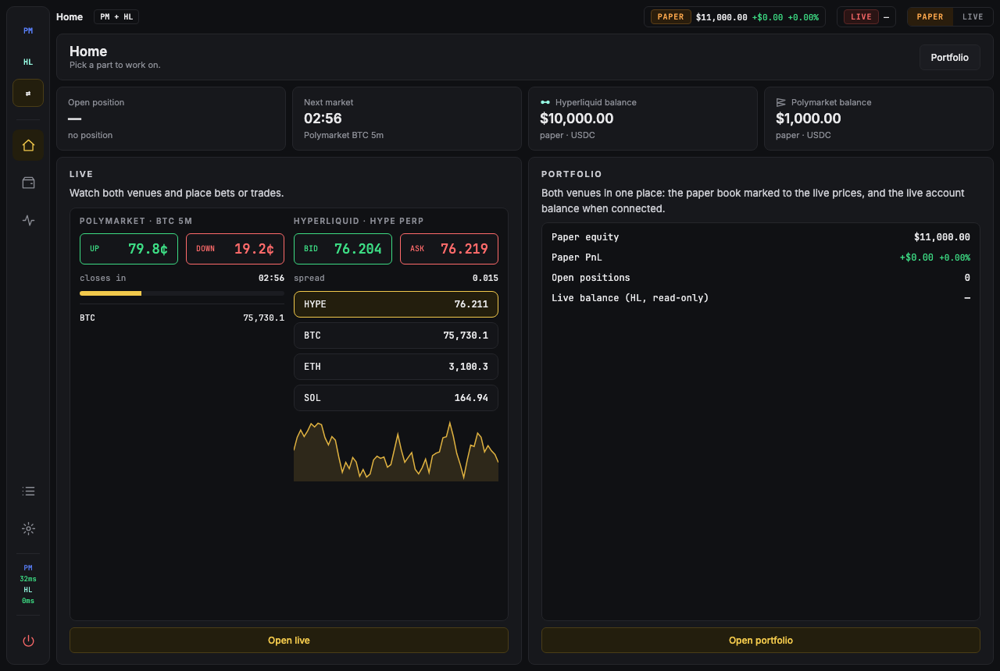
`docs/screens/01-home-general.png`

**Polymarket.** Live card shows UP and DOWN tiles, the countdown with a progress bar and the BTC price. Strategy tiles show Polymarket strategies and their formula.

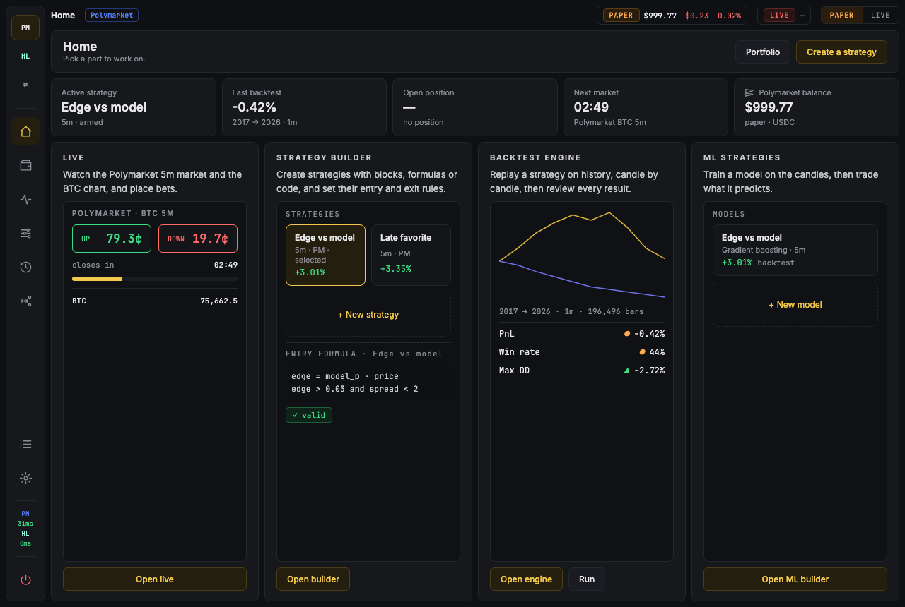
`docs/screens/07-home-polymarket.png`

**Hyperliquid.** The Live card has the same structure: BID and ASK tiles, a spread row, four full-width coin tiles (HYPE, BTC, ETH, SOL; a click selects the coin) and a mini chart.

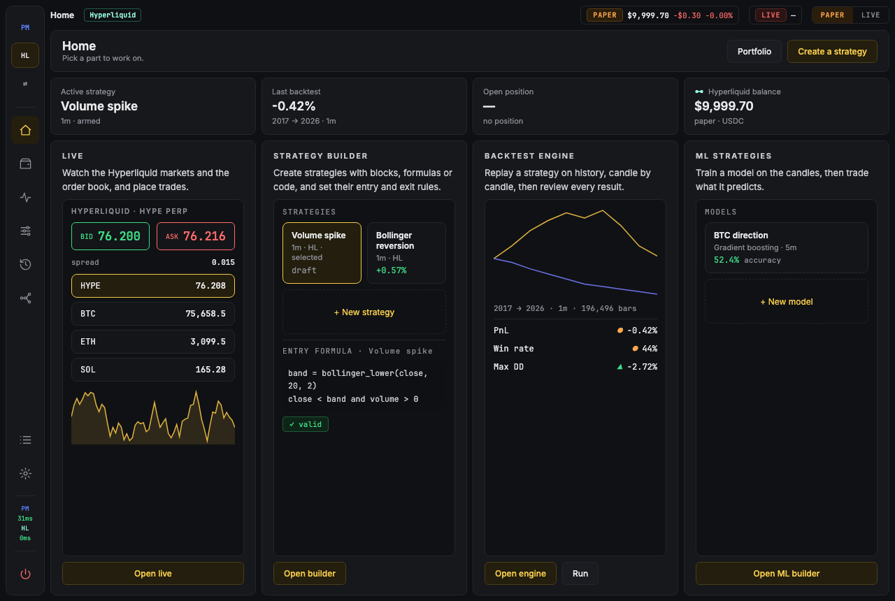
`docs/screens/11-home-hyperliquid.png`

### 2.2 Portfolio

Header with the active mode badge, four figure cards (Live equity, Paper equity, Day PnL live, Day PnL paper), the **Live book** and the **Paper book** side by side, and the paper return curve underneath.
- The book that receives orders (the one matching the PAPER / LIVE switch) is outlined.
- Paper book: one row per open position (venue tag, market, side, size, entry, mark, PnL in cash and in percent, Close), the last closed positions with their exit reason, the cash of each account, and a "Reset paper account" button. The default paper accounts are $1,000 for Polymarket and $10,000 for Hyperliquid.
- Live book: read only. It shows the Hyperliquid account value (margin used, open notional) and the Polymarket positions value once addresses are set in Settings.
- The percentage basis: on a position, the margin (perp) or the stake (bet); on the account and the day, the start equity; on a book, the total margin and stakes at risk.
- The curve is the paper return in percent, sampled every 5 seconds; it says "Collecting samples" until it has two points.

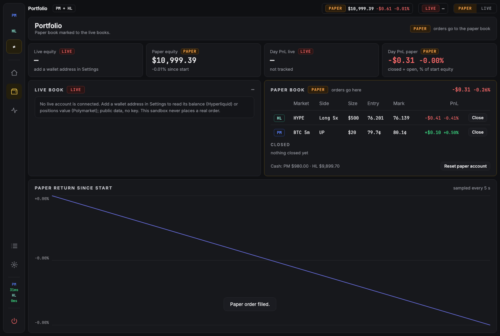
`docs/screens/04-portfolio-general.png`

### 2.3 Live

Two columns, one per venue, and an action bar per venue in the footer.

**General.** Polymarket on the left, Hyperliquid on the right. Under each chart, a "Paper positions" strip lists that venue's open paper positions (PnL in cash and percent, Close). The footer has a **Polymarket bar** (venue tag, selected side, stake, mode badge, Bet UP, Bet DOWN with the live ask in cents) and a **Hyperliquid bar** (venue tag, coin, size in dollars, leverage, TP %, SL %, mode badge, Buy / Long, Sell / Short).

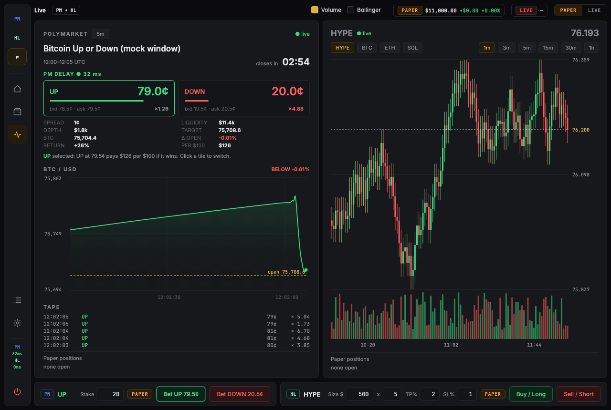
`docs/screens/02-live-general.png`

With a paper long and a paper bet open:

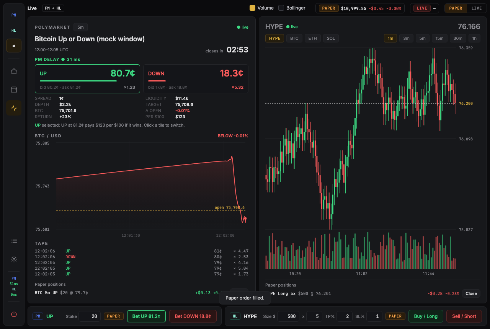
`docs/screens/03-live-general-with-positions.png`

**The Polymarket column** (also the left column on the Polymarket-only window): market title, window times in UTC, countdown, latency line, two **selectable tiles** (UP, DOWN) with price in cents, a bar, bid and ask and the payout multiple. Under them, two columns of figures (spread, liquidity, depth, target, BTC, delta from open, return, payout per $100). The spread, return and per-$100 figures follow the **selected** tile; a line states what the selected side pays. The selected tile takes its colour (green for UP, red for DOWN) and keeps it under hover; the matching bet button is emphasised. Below, the BTC chart and the tape of the latest trades.

**The BTC chart** is animated: the time axis is a rolling minute that moves continuously, the curve is smoothed (samples averaged into 500 ms buckets), the vertical range eases slowly, and the head glides to each new price with a soft pulse. Each 5-minute window has its own dashed "open" target segment: the current one grows from the right edge and earlier ones scroll off to the left, so the animation never restarts at a rollover. The line is red below the target and green above. It fills the whole plot width (history is backfilled from 1-minute candles; if history is missing, a dashed flat segment reaches the left edge).

**Polymarket only.** The column plus a larger copy of the BTC chart with the edge panel (Model P(up), market ask, edge in cents) and "Your paper bets" (side, stake, entry, current value and PnL, Close). The footer has the strategy bar (strategy, armed, model_p, price, edge, signal), Auto-bet, the stake, the mode badge, and the two bet buttons. No Volume or Bollinger toggles.

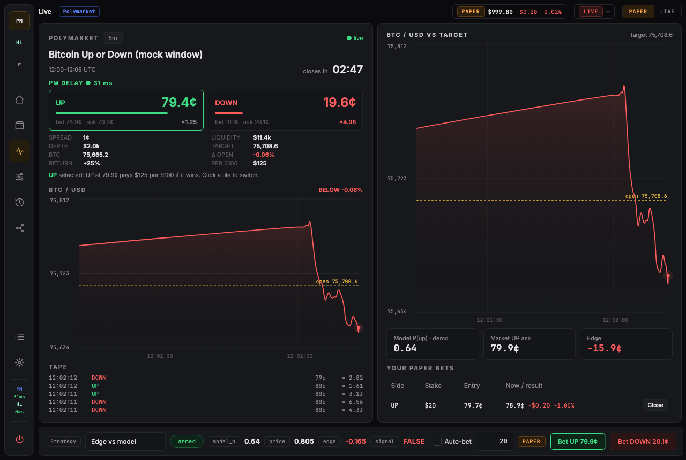
`docs/screens/08-live-polymarket.png`

Selecting the DOWN tile:

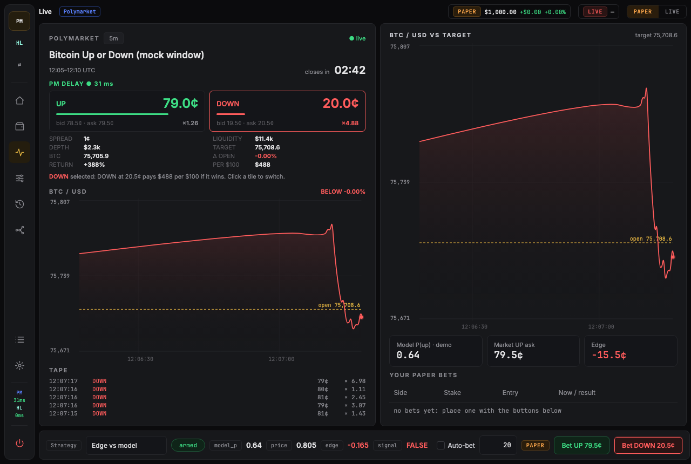
`docs/screens/21-live-polymarket-down-selected.png`

**Hyperliquid only.** A large candle chart (volume strip and optional Bollinger bands from the top bar), coin pills (HYPE, BTC, ETH, SOL) and timeframe pills (1m to 1h), with the live mid price. On the right: the **order book** (five asks, mid and spread, five bids, with size bars), a **Paper positions** card, and the **Trade** form (size in dollars, leverage, TP %, SL %, margin, estimated liquidation prices, fee, Buy / Long, Sell / Short). The footer shows the strategy bar and Auto-trade.

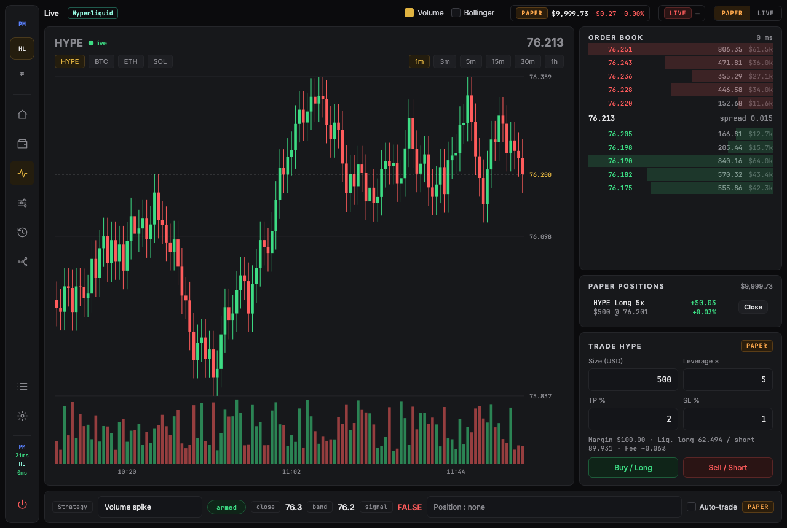
`docs/screens/12-live-hyperliquid.png`

**States.**
- LIVE mode: placing an order shows "Live trading is not available in this sandbox. Switch to PAPER to place orders."

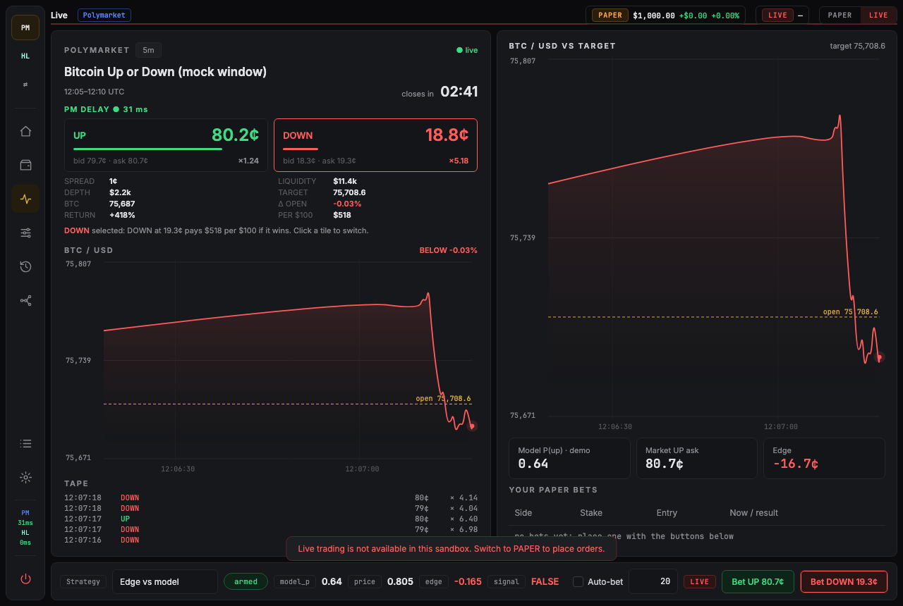
`docs/screens/22-live-mode-refuses-orders.png`

- A feed that is not delivering: the column says `error` (or `stale`, `connecting`) and `demo data`, a chip appears in the top bar, and the cause is in Logs. In this capture Polymarket is on demo data while Hyperliquid is connected but its candles did not load, so its chart is labelled as a demo chart.

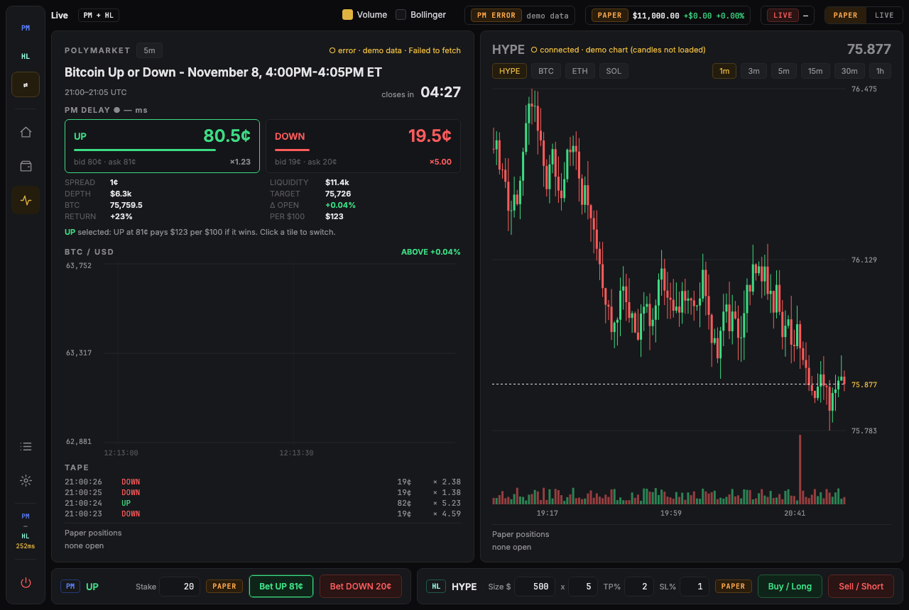
`docs/screens/23-feeds-offline.png`

### 2.4 Strategy builder (PM and HL only)

Left column: the **Strategy** card (name, timeframe, venue tag) and the list of that venue's strategies (name and performance, selected one outlined) with "Create a strategy" at the bottom. Right column: the editor tile and the Results tile.

The editor tile has **ENTRY RULES / EXIT RULES** tabs and a **Rules / Formula / Code** mode switch.
- **Formula**: three panels. Blocks (search, then Variables, Data, Indicators, Maths as colour-coded chips); the Formula (Variables lines, the "when" line of chips, "add a line", a number field with Add and Reset, the formula text with a valid badge); the Selected block and its Live values.
- **Rules**: a LET section (variable = expression), CONDITIONS grouped (GROUP 1 with an All (AND) selector, rows of left / operator / right, add row, add group), the resulting code and its validity, and a Variables list on the right.
- **Code**: an editable `formula.txt` with syntax colours, the Variables list with types, and the Values panel for the selected variable.

Venue differences: the data variables, the "when" wording and the formula example. Polymarket: `price, model_p, edge, spread, liquidity, days_left, btc, target`, `BET UP WHEN` / `CASH OUT WHEN`, `edge = model_p - price`. Hyperliquid: `open, high, low, close, volume, funding, oi, model_p`, `BUY WHEN` / `SELL WHEN`, a Bollinger band example.

The Results tile has Overview / Compare. Overview: caption, six figures, the strategy curve against a random-buy baseline and buy-and-hold, and the "How trades end" bars. Compare: adds a strategy to the curve and shows the walk-forward result and the TP x SL sweep heatmap (green to red).

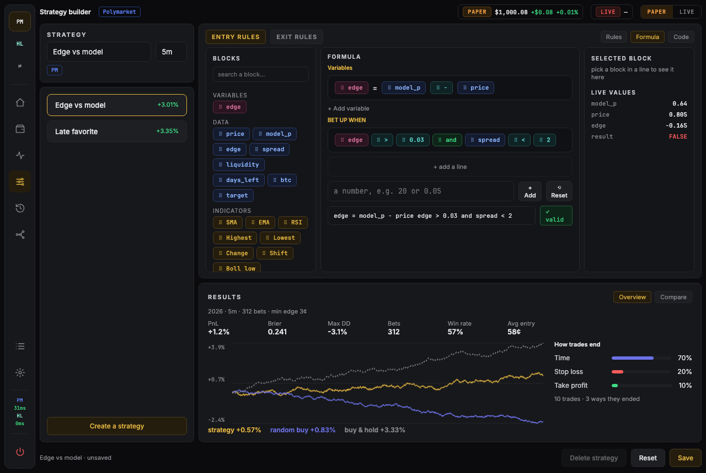
`docs/screens/09-builder-polymarket.png`

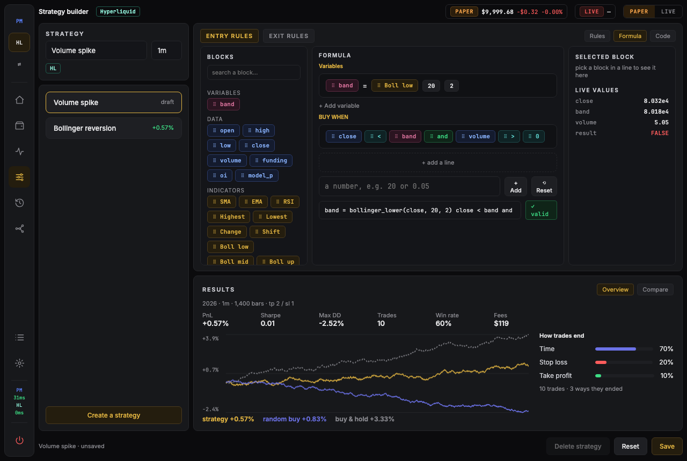
`docs/screens/13-builder-hyperliquid.png`

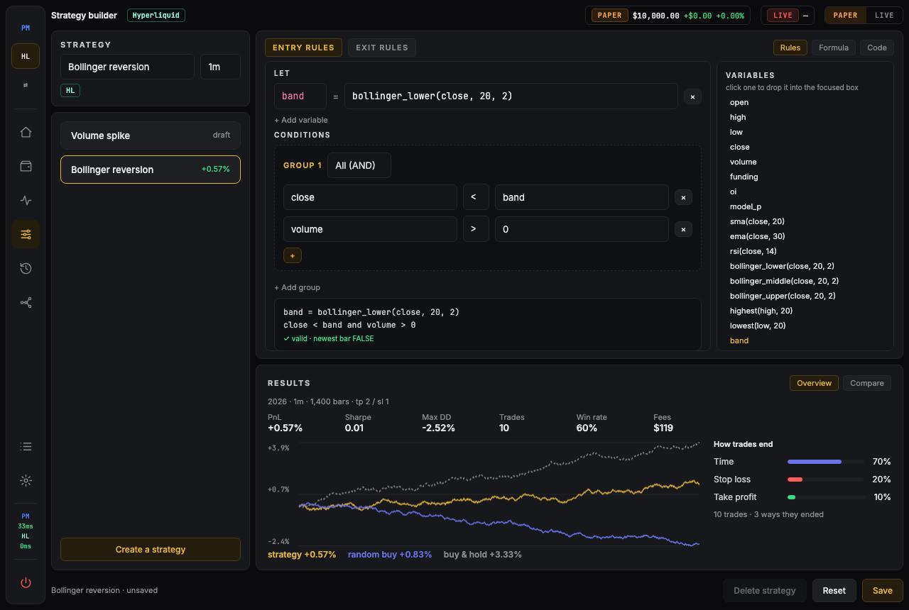
`docs/screens/17-builder-rules-hyperliquid.png`

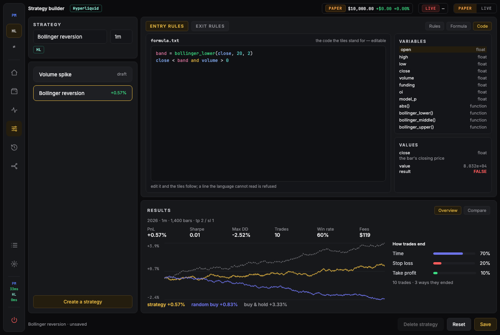
`docs/screens/18-builder-code-hyperliquid.png`

### 2.5 Backtest (PM and HL only)

A large replay card (title, status line, Restart, speed, Run, progress bar, twelve statistics, the candle chart with entry and exit markers and optional volume), a right column of parameter cards, and a Results card underneath.
- Right column: History (from and to year, timeframe buttons, Download, source note), the parameter card, Strategy (picker, description, Create a strategy), and Save run / Load run.
- Hyperliquid parameters (card "Backtest value"): initial capital, sizing, position %, TP %, SL %, max cash, fee %, dynamic TP, reverse % to close. Statistics: PnL, equity, Sharpe, drawdown, max DD, max gain, streak, best win, worst loss, trades, win rate, fees.
- Polymarket parameters (card "Bet value"): initial capital, stake, max entry price in cents, min edge in cents, fee on wins, slippage in cents, exit mode, daily loss limit, max bets per day. Statistics add bets, win rate, average entry and Brier. Trade-end bars: resolved win, resolved loss, exited early.
- Results card: Overview (figures, equity curve against baselines, drawdown strip, "How trades end", PnL distribution) and Trades (a table of trades with side, entry, PnL percent, exit reason).

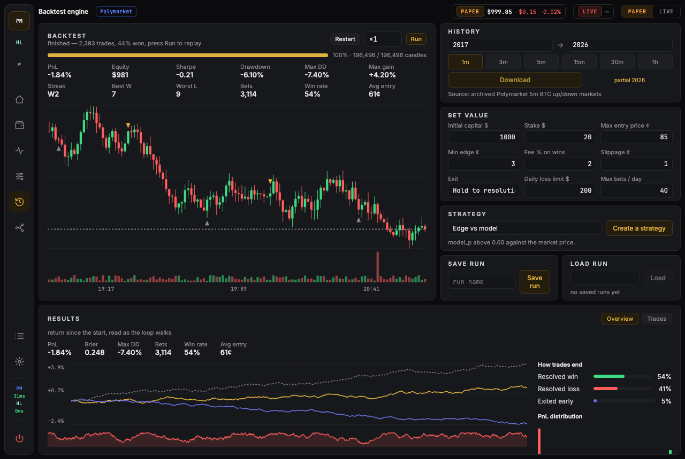
`docs/screens/10-backtest-polymarket.png`

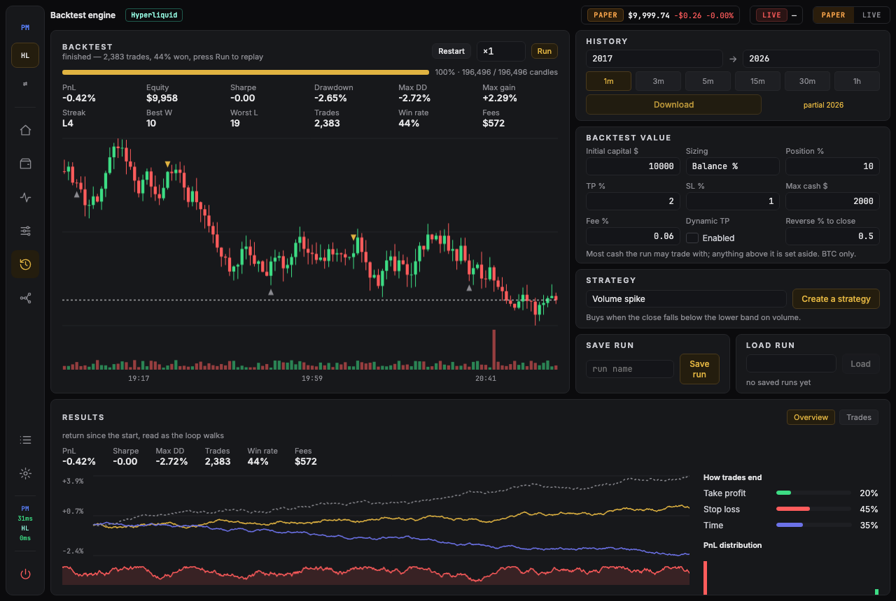
`docs/screens/14-backtest-hyperliquid.png`

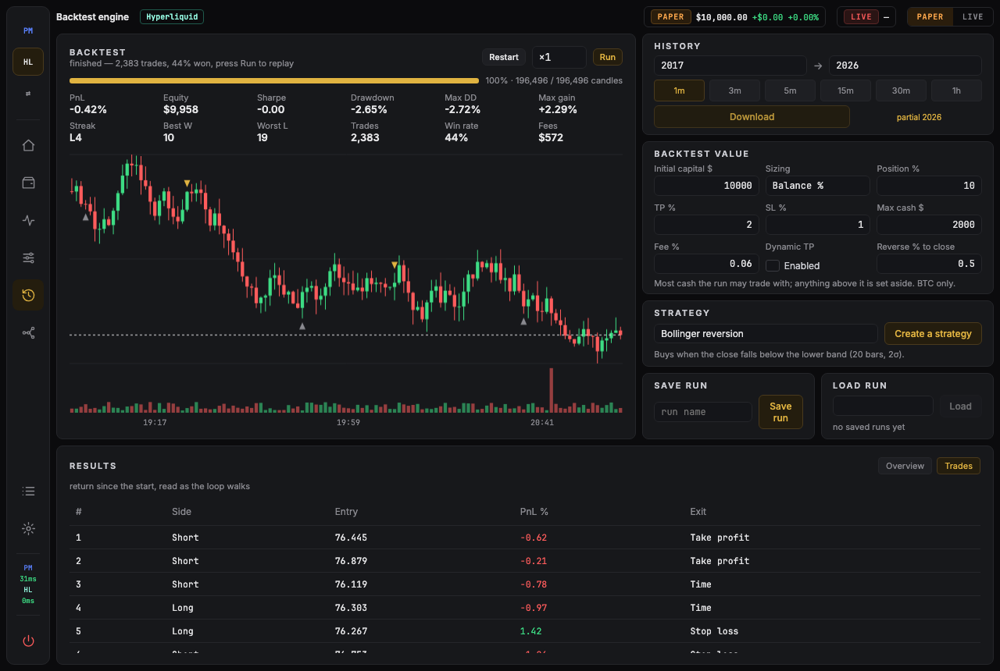
`docs/screens/19-backtest-trades-hyperliquid.png`

### 2.6 ML strategy builder (PM and HL only)

Three cards and a results card. **Data and features** (market, candles, source, a Train 60% / Valid 20% / Test 20% split bar, ten feature checkboxes, a custom-feature button). **Target and model** (what to predict, horizon, minimum move, four model rows plus "Build my own model", model settings, Auto-tune, Train, Stop). **Trading rule** (the model outputs `model_p` = P(up), the two probability thresholds, a venue specific field, retrain interval, walk-forward, test-set figures, Edit exit rules, Open in formula). The venue specific field is "min edge vs market price" on Polymarket and "leverage" on Hyperliquid. **Results, test set**: train / valid / test accuracy, AUC and log loss, feature importance bars, the strategy curve on the test period, and Open, Save strategy and Run full backtest.

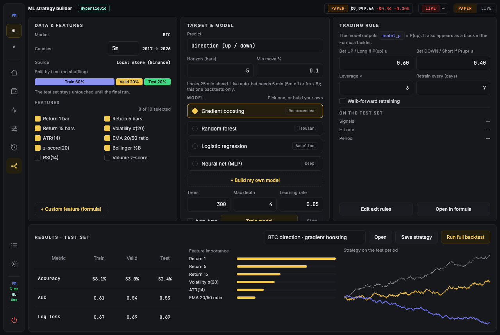
`docs/screens/15-ml-hyperliquid.png`

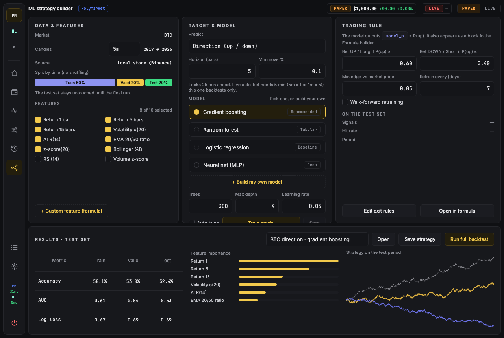
`docs/screens/20-ml-polymarket.png`

### 2.7 Model builder (PM and HL only)

Opened from "Build my own model" (the ML entry stays highlighted in the rail). Top row: model name, start preset, Visual / Code. Three columns: **Layers** (core and sequence layer buttons), **Architecture** (input, the editable layer stack with arrows, output, "Add layer", the training settings and early stopping), and **Layer guide** and **Validator** (what the selected layer does, its main setting and what to watch out for; valid or error and warning lines). Footer: a status line, Cancel, Save to my models, Use in strategy.

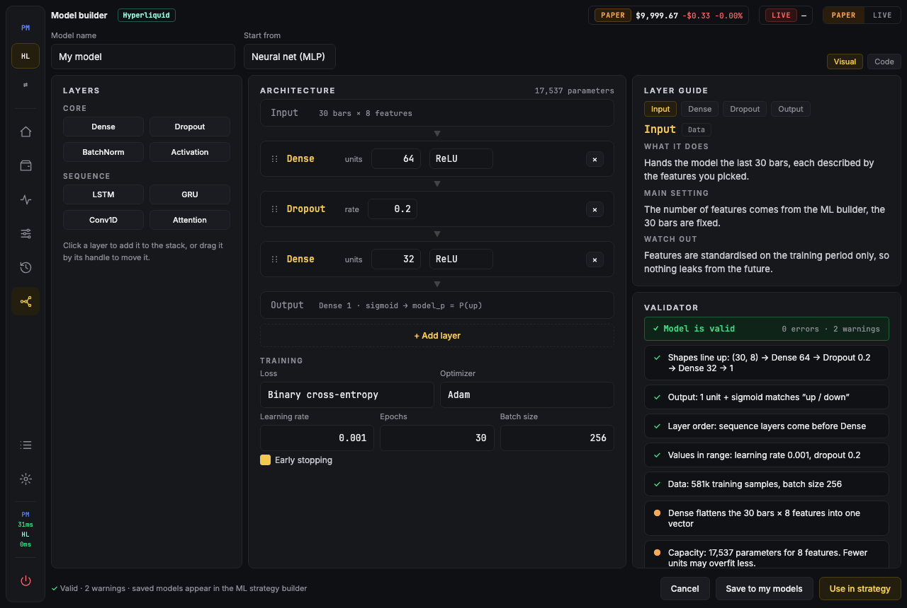
`docs/screens/16-model-builder.png`

### 2.8 Logs

Statistics (orders, filled, rejected, warnings, day PnL with percent), a filter row (search, source pills All / Polymarket / Hyperliquid / Strategy / System, origin, level and strategy selectors, Pause, Clear, Export), the event table (time, level, source with venue icon, origin, event, message), and a Details panel for the selected row with Copy and Open in Live. The footer counts events and has Auto-scroll. Events are real: feed connections and drops, paper orders, closes, settlements and rejections. On a single venue, the table shows that venue plus System and Strategy rows.

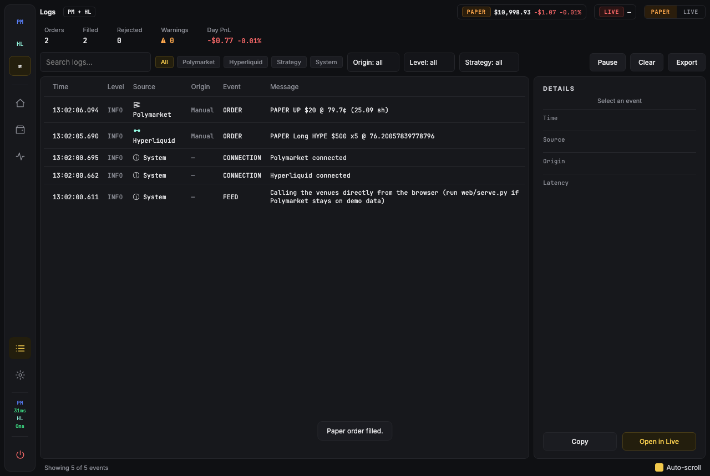
`docs/screens/05-logs-general.png`

### 2.9 Settings

A header with the venue connection status, then two columns. Left: the **Polymarket** account card, the **Hyperliquid** account card, and the Security note. Right: Backtest defaults, Trading defaults (leverage and margin only for Hyperliquid, stake only for Polymarket; confirm before ordering, auto-bet, place real orders) and General (start page, data folder). Footer: "All changes saved", Reset to defaults, Cancel, Save.
- Both accounts are always visible.
- The Hyperliquid card has a working **wallet address** field: "Test connection" reads the perps account value from the public address (no key) and feeds the LIVE chip and the Portfolio. The Polymarket card reads the value of the open positions of a public address the same way (its USDC cash balance needs credentials, so it is not shown). Addresses are stored only in the browser.
- The other account fields (private keys, builder keys) are display only in this design.

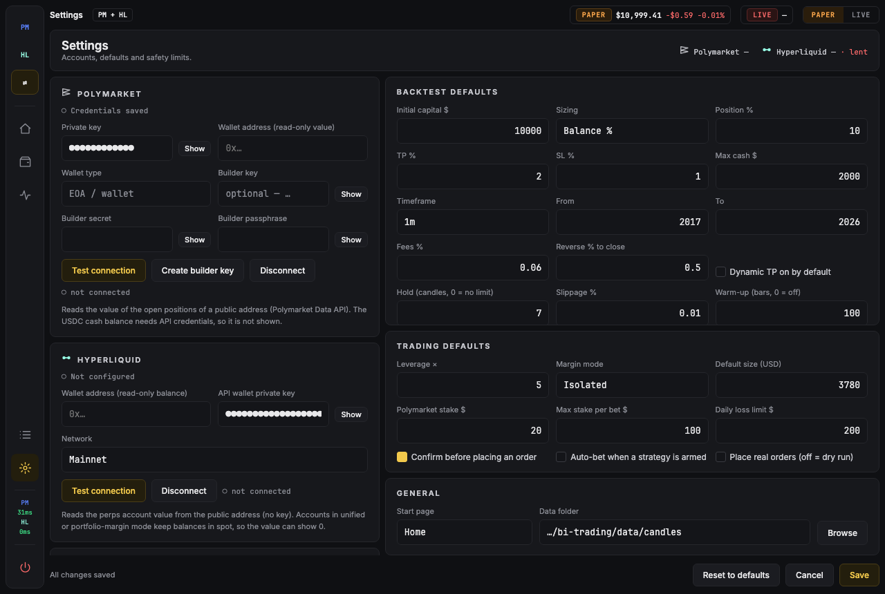
`docs/screens/06-settings-general.png`

## 3. Behaviours that apply across windows

**Paper trading.**
- Polymarket bets fill through the live ask side of the order book for the stake, and are marked at the bid. They can be closed before the market ends; otherwise they settle at the end of the 5-minute window on the market's resolved outcome (if it is not yet published after 30 seconds, on BTC against the window open price, flagged "est.").
- Hyperliquid positions fill by walking the live order book for the notional, with a 0.06% fee per side. They close on take profit, stop loss (both as a percent of price movement), manually, or when 90% of the margin is lost (liquidation).
- Several positions can be open at once. A rejection (no feed, not enough cash or depth) shows a message and a Logs row.

**Percent next to cash.** Every cash PnL is followed by its percentage, with the bases listed under Portfolio.

**Data sources.** Hyperliquid: candles, order book, mid prices and BTC best bid and offer (live), plus the optional account value. Polymarket: the current 5-minute BTC up/down market, its order books and trades, plus the optional positions value. A small local relay (`web/serve.py`) makes the venue calls the browser cannot make itself. If a source is unavailable, the affected card says `demo data` and keeps working with synthetic values.

**Data that is demo only:** strategy signals and `model_p`, every Builder, Backtest and ML figure and curve, and the Logs history from before the session.

## 4. Code map

`web/index.html` (shell), `web/styles.css` (both palettes and all components), `web/views.js` (one entry per window), `web/app.js` (router, rail, top bar, in-place patching, actions), `web/chart.js` and `web/btcchart.js` (charts), `web/feeds.js` (live feeds and accounts), `web/paper.js` (paper engine), `web/synth.js` (demo data), `web/serve.py` (static server and relay), `web/test/` (tests and the offline demo).
